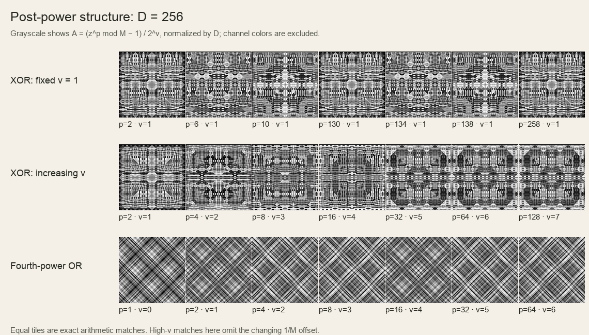

# Post-power range in the rug renderer

The inherited quadratic sampling range is neither a minimal range nor a completeness theorem. The natural parameters are the exponent's power-of-two valuation and its odd part. For a fixed valuation, the odd part has a finite, provable cycle. Increasing the valuation eventually stops changing the normalized arithmetic structure, although the modulus and available channel offsets continue changing. The app and saved favorites have not been modified by this investigation.

**Notation and scope.** Let `D = 2^d` be the renderer's actual lookup domain, `p = 2^v u` with positive odd `u`, and `M = D·2^v`. The post-power is `z^p mod M`; channel `c` evaluates `(a_c·z^p + b_c) mod M`, normalized by `M`. This report distinguishes equality of the post-power function, equality of its normalized structure up to a cyclic offset, and equality after adjustable channel coloring. Those are different equivalence relations. Assertions about complete domain tables can overcount distinctions in a smaller visible crop; color tuning or quantization can identify more outputs.

For the field, `D = 2·nextPowerOfTwo(max(reference.width, reference.height))`. For a main border or guard, `D = 2·reference.period`. In Adapt mode, use current geometry instead of the saved reference. The generator's argument `N = 2·max(current field width, current field height)` is a separate quantity: it determines the inherited exponent sampling range for every region. `N` and `D` coincide for a power-of-two field width at its generation size, but generally differ for borders, fractional shapes, and retained references. The renderer's displayed `N = 2L` is also not necessarily its border lookup domain.

**Exact exponent equivalence for diagonal XOR.** Both diagonal transforms give coordinates of opposite parity, so their XOR is always odd. For `D >= 8`, every odd input satisfies:

```text
z^[2^v(u + D/4)] ≡ z^[2^v u]  (mod D·2^v).
```

Consequently, at each fixed `v`, the complete set of canonical positive odd parts is `1, 3, ..., D/4 − 1`. There are exactly `D/8` distinct complete odd-input post-power tables. A complete square XOR motif encounters every odd `z` in `[0,D)`, so the distinction is observable before coloring. Odd exponents are simply the `v = 0` case. For example, at `D = 256`, the odd exponents have just 32 classes, represented by `1,3,...,63`; adding 64 produces the same raw function.

The standard unit-group result is that odd residues modulo `2^k`, for `k >= 3`, are generated by `−1` and `5`, with `5` of order `2^(k−2)`. See Keith Conrad's [Theorem 2.3 and Appendix B](https://kconrad.math.uconn.edu/blurbs/gradnumthy/primepowerunitsandGLnQ.pdf). Applying it at `k = d+v` makes the exponent increment `2^v·D/4` a period; the order of `5` proves no smaller odd-part period works on every odd input. Reducing `u` by this period retains its oddness and hence retains `v` and the modulus. This is why reducing `p` indiscriminately modulo `D/4` would be wrong for even exponents.

A canonicalization that preserves the complete XOR image, including existing channel draws, is:

```python
v = (p & -p).bit_length() - 1
u = p >> v
canonical_p = (1 << v) * (u % (D // 4))  # D >= 8; the remainder is odd and nonzero
```

This preserves `M`, all post-power values on odd inputs, and the derived channel multipliers and offsets. Coordinate transforms, sampling, and colors therefore remain unchanged. Small domains require separate handling: at `D = 2` the only odd residue is 1; at `D = 4` all positive even powers of odd residues equal 1 modulo their corresponding modulus. The app's one-cell guard motif is explicitly rendered as a solid sample.

**What the inherited q range covers.** At `N = D = 2^d`, the old even-power rule samples `q = 1,...,D²/32 − 1` and sets `p = 2q`. Its largest possible valuation is `2d−5`. The number of distinct `(v, post-power function)` pairs it covers is:

```text
(d − 1)·D/8 − 1.
```

For `v = 1,...,d−2`, all `D/8` odd-part classes occur. At higher valuations the class counts halve successively to one. Summing the full levels and the geometric tail gives the formula. These counts refer to the full raw XOR table plus its modulus, not to distinct rendered rugs with independently randomized colors.

| D = N | Sampled q choices | Odd-power classes | Even function/modulus pairs | Largest v sampled |
| ----: | ----------------: | ----------------: | --------------------------: | ----------------: |
|    64 |               127 |                 8 |                          39 |                 7 |
|   128 |               511 |                16 |                          95 |                 9 |
|   256 |             2,047 |                32 |                         223 |                11 |
|   512 |             8,191 |                64 |                         511 |                13 |
| 2,048 |           131,071 |               256 |                       2,559 |                17 |

The first four rows were directly counted; the final row follows from the proved formula. For odd powers, using the same q range and `p = 2q−1` covers only `D/8` distinct exponent functions, repeatedly. At `D = 2048`, 131,071 candidate q values represent just 256 odd-power tables.

Uniform q sampling strongly favors low valuations: the even powers have approximately one-half of their probability at `v = 1`, one-quarter at `v = 2`, and one-eighth at `v = 3`, continuing geometrically. Exactly, the number of choices at level `v` is `2^(2d−5−v)` for `1 <= v <= 2d−5`. Sampling valuations uniformly would change the generator's visual distribution. Eliminating redundant exponents does not itself eliminate new colored rugs, because channel draws are randomized separately.

When `N = 2^n` and `D = 2^d` with `n >= d >= 3`, the same inherited q range covers `(2n−d−1)·D/8 − 1` even function/modulus pairs. For example, a field-generation argument of `N = 2048` with a main-border domain of `D = 128` samples 131,071 q values for 223 pairs. Guard domain `D = 64` gives 119 pairs. Arbitrary `N` or a reference domain larger than the generation argument needs counting from the actual range instead of either closed formula.

**Why high valuations stabilize without making the pattern constant.** For odd `z` and `v >= 1`, define:

```text
A_v(z) = (z^(2^v) − 1)/2^v  (mod D).
z^(2^v) mod M = 1 + 2^v A_v(z).
```

Every `A_v(z)` is divisible by 4, because an odd square is 1 modulo 8. Squaring once more gives the recurrence:

```text
A_(v+1) = A_v + 2^(v−1)·A_v²  (mod D).
```

The correction is divisible by `2^(v+3)`. Thus the entire coefficient table stabilizes for `v >= max(1,d−3)`. This uniform bound is sharp for `d >= 5`: `z = 3` has a correction of exactly that valuation, so the preceding level differs. At `D = 256`, the coefficients for exponents 32, 64, 128, and all further powers of two are identical; at `D = 2048`, stabilization begins at exponent 256.

This does not establish a finite range containing every exact colored image. The normalized power is `A_v/D + 1/M`, so its small offset still changes. With fixed raw channel draws, write `a = 2·draw_mult + 1` and `b = draw_add` before reduction modulo `M`; then:

```text
channel(z) = frac((a + b)/M + (a mod D)·A_v(z)/D).
```

Once `A_v` stabilizes, the channel's spatial structure is fixed and only its cyclic offset changes with `v`. That offset can still materially change HSV or OKLCH colors; sine-mapped channels and quantization can also identify additional states. Calling all higher exponents exactly identical would be incorrect.

There is another redundancy when the channel multipliers are adjustable. For `v >= max(1,d−4)`, expanding `(1 + 2^v A_v)^u` shows `A_(v,u) = u·A_(v,1) mod D`, since the nonlinear terms vanish. The odd factor `u` can then be absorbed into each odd channel multiplier, with a compensating channel offset. This is equality of available colored families under parameter changes, not equality while holding those channel parameters fixed.

**Squared and fourth-power OR.** A diagonal OR combines an odd pre-powered coordinate and an even one. Squared OR therefore has odd combined values `z ≡ 1 mod 4`; fourth-power OR has `z ≡ 1 mod 16`. For these odd inputs the odd-part exponent periods are respectively `D/4` and `D/16`, using period 1 when the domain is too small. The actual motifs contain 5 or 17 at the nondegenerate sizes, which witness the minimal periods. Fourth-power OR consequently has `D/32` odd-part classes per valuation for `D >= 32`, rather than XOR's `D/8`.

For a family with `z ≡ 1 mod 2^s`, every coefficient `A_v` is divisible by `2^s`, including `v = 0`. The same recurrence stabilizes at `v >= max(0,d−(2s−1))`. Thus squared OR has threshold `max(0,d−3)`, while fourth-power OR has threshold `max(0,d−7)`. At `D = 256`, fourth-power OR's normalized coefficient structure already stabilizes at exponent 2.

Straight OR also encounters even `z`. Its nonzero even squared-OR values have valuation at least 2, and its fourth-power-OR values have valuation at least 4. They are all zero after post-power exactly once the sufficient worst-case condition `s·p >= d+v` holds. Before that threshold, they can distinguish exponents that have identical odd-input behavior. For example, at `D = 64`, `5^1` and `5^17` agree modulo 64, but `4^1 = 4` and `4^17 = 0` modulo 64. Naively replacing every straight-OR exponent by its smallest odd-input representative would change some patterns. Preserve the low-exponent transient, and choose the smallest representative in the periodic tail that remains above the saturation threshold.

**Post-power and spatial frequency are different questions.** Under the current rule `M = D·lowbit(p)`, the exact arithmetic axis period of the full unscaled motif is `T = D/2` for diagonal XOR and for squared OR, for `D >= 8`. Fourth-power OR has period `D/4 = T/2`, in both diagonal and straight orientations, for `D >= 32`. These periods hold for every positive post-power. Specific color settings can collapse arithmetic distinctions and make a colored image appear to have a smaller period.

The sufficient periods follow from coordinate transforms and pre-power congruences. Minimality can be witnessed at a half-period displacement: XOR and squared OR encounter combined values 1 and `1+D/2`; fourth-power OR does so at displacement `D/8`. Their post-powers differ by `M/2` for every `p`, so the shorter displacement cannot be an arithmetic period. In the diagonal XOR motif, for instance, `(y,x) = (1,0)` and `(1,T/2)` give those two values. Fourth-power pre-powered coordinates already have period `D/4`, explaining its doubled spatial frequency. For `D <= 16`, diagonal fourth-power OR is constant; straight fourth-power OR has a parity pattern at domains 4, 8, and 16. Other tiny-domain degeneracies should be handled separately.

Increasing the valuation at a fixed modulus can shorten repetition, but increasing it while also multiplying the modulus by `lowbit(p)` does not generally do that. The app uses the second construction. This is the main reason the post-power should not be presented as a generic motif-frequency control.

**Checks and saved favorites.** The accompanying exact-integer script checked 173,018 identities, including exponent cycles, coefficient stabilization, sharpness, odd-part absorption, OR saturation, and channel offsets. It enumerated distinct raw odd-input tables for domains 8 through 128 and counted inherited exponent classes through domain 512. It also checked both axis periods in 675 complete motif cases across domains 8 through 256, all supported families and orientations, and sampled valuations and odd parts. The theoretical results apply beyond these finite checks; the proofs provide that extension.

A further 30,000 input checks verified safe exponent reductions in 108 region entries across 27 current saved-settings files. The check uses all odd XOR inputs and congruence-class supersets for OR; straight OR retains unsaturated transients. Locked outer guards use their effective inner-guard style. Examples from `fav13.json` are field `49946 → 794` at `D = 2048`, main border `258298 → 58` at `D = 128`, and inner guard `144912 → 16` at `D = 64`. Each reduction preserves its modulus and every relevant post-power value, so the existing channel draws and rendering are unchanged. No saved file was rewritten.



The figure shows the coefficient `A/D`, omitting channel coloring and the `1/M` offset. Each panel is rendered at its native 128 × 128 cell resolution. The first row shows exact aliases at fixed valuation; the second shows XOR stabilization; the third shows the earlier fourth-power-OR stabilization. The figure therefore illustrates the proved arithmetic distinctions rather than asserting visual equivalence of full HSV/OKLCH renderings.

**Small-size sampling bounds.** At the smallest 1.25:1 field, the short side is 8 and `N = 20`, so `N²/32 = 12.5`. Previously, passing the fractional sampling limit `11.5` to the integer sampler could produce `q = 1.5` and supposed-even `p = 3`. At 1.75:1 and short side 8, `N = 28` had the same problem. The app now samples from `ceil(N²/32) − 1` choices, giving exactly the positive integers below the exclusive bound: `q = 1…12` and `q = 1…24`, respectively. Integer bounds retain their existing sampling and seed results.

**Recommended direction.** Expose or internally represent `p` as `(v,u)`, with `u` in a canonical cycle determined by the actual region domain. Retain the current generator as a versioned legacy recipe for reproducibility. A new recipe can choose `v` deliberately, favoring low levels similarly to the current distribution and representing the stabilized tail explicitly rather than claiming a finite exact-completeness bound. For straight OR, preserve the low-exponent transient. For existing XOR and diagonal-OR settings, canonicalizing the odd part is an exact algebraic simplification; for high-valuation states, collapsing valuations would instead require a color-offset transformation and should not be done silently. Large decimal exponents are not a measure of motif complexity, and sampling more of them is not a principled way to increase diversity.

Run `python3 research/2026-10-11-post-power-range.py` from the rug directory to regenerate the JSON checks. The optional figure script requires Pillow; it uses the macOS Arial font. The script, JSON results, figure source, and native-resolution figure are saved beside this report.
