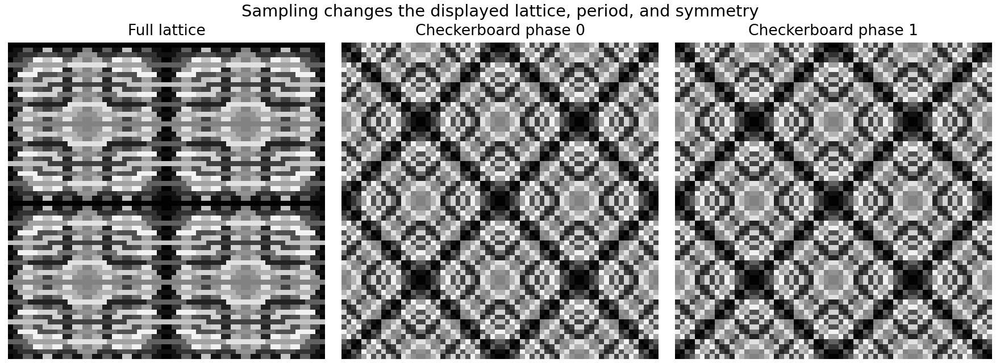
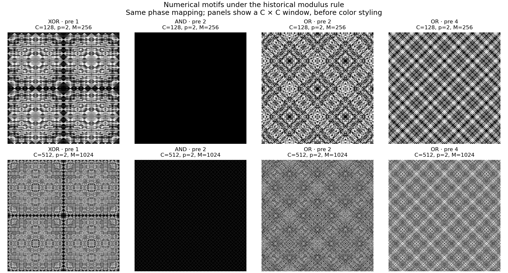
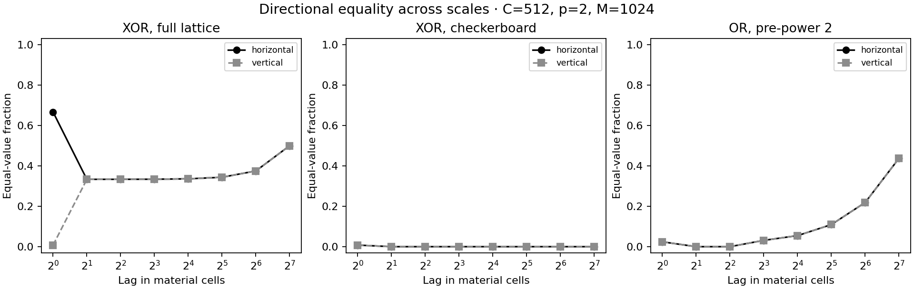

# Pattern spaces, symmetry, and canonical sampling for the rug generator

## Purpose and principal results

This investigation continues the [October 13 XOR post-power theory](https://github.com/yumichael/rug/blob/e1fde1ca97c9644511d4b4e9a264f532a75b1090/research/2026-10-13-post-power/2026-10-13-xor-post-power-theory.md), with the proposed generator architecture as its motivation. The repository was read at commit `e1fde1ca97c9644511d4b4e9a264f532a75b1090`. The application and existing research have not been changed.

The generator should separate **rug construction**, **pattern style**, **pattern variation**, and **color style**. A material is a centered, infinite periodic numerical pattern together with its color mapping. Each rug component shows a crop of that material. The rug's geometric center is the common material origin.

The main mathematical conclusions are:

| Question                                                                      | Result                                                                                                                                                   |
| ----------------------------------------------------------------------------- | -------------------------------------------------------------------------------------------------------------------------------------------------------- |
| Does trivial post-mult/post-add identify all distinct pattern families?       | No. Different post-powers can belong to the same odd-affine output family.                                                                               |
| What changes for the established diagonal XOR family?                         | At coordinate domain C ≥ 32, there are 5C/32 odd-affine classes, including C/32 even-power classes. The old count (c − 3)C/8 counts a finer equivalence. |
| Is there a particularly simple even-XOR sampler?                              | Yes: one integer k modulo C/32 indexes every even-power affine class.                                                                                    |
| Can that index remain coherent as periods change?                             | Yes. Doubling C doubles the index range; reduction of k gives the natural smaller-domain class.                                                          |
| Can sampling remove XOR's directional texture?                                | Checkerboard reindexing gives full square symmetry for even post-powers, with the same exact axis period C/2. Its two standard phases are identical.     |
| Does even pre-power help symmetry?                                            | Every shared even pre-polynomial gives full square symmetry in a centered straight or diagonal construction, before any post-operation.                  |
| Does the XOR modulus rule extend directly to AND?                             | No. AND's even inputs can be annihilated by post-power. A shift-difference valuation theorem supplies the exact replacement.                             |
| Does every monomial family have finitely many affine classes at fixed period? | No. Squared-pre AND already has infinitely many, even at the smallest valid modulus.                                                                     |
| Can arbitrary pre-powers be classified finitely?                              | Yes, at fixed coordinate modulus. Their complete functions have a finite transient and a finite exponent cycle.                                          |
| Can arbitrary polynomials be classified finitely?                             | Yes, at fixed arithmetic precision. Canonical polynomial functions and finite image modules give exact classifications.                                  |
| Is a finite precision limit optional for unrestricted post-polynomials?       | No. Fixed period and minimal modulus alone still permit infinitely many affine classes.                                                                  |

Closed formulas below are proved for the families to which they apply. The general polynomial solution is an exact finite procedure after specifying precision and coordinate-domain bounds; it is not a claim that every large catalogue has been enumerated. The accompanying [script](pattern_space.py), [results](results.json), and figures make the finite experiments reproducible.

---

## 1. Construction, coordinates, and the shared material

### 1.1 General arithmetic construction

Let the coordinate lookup modulus be

$$
C=2^c.
$$

Two affine coordinate forms produce integers $a(x,y)$ and $b(x,y)$. Apply the **same** integer polynomial $P$ to both operands, reducing before the bitwise operation:

$$
A=P(a\bmod C)\bmod C,\qquad B=P(b\bmod C)\bmod C.
$$

For a combiner $\circ\in\{\mathrm{XOR},\mathrm{AND},\mathrm{OR}\}$, define

$$
Z=A\circ B,\qquad 0\le Z<C.
$$

An integer post-polynomial $H$ produces

$$
F(x,y)=H(Z(x,y))\bmod M,\qquad M=2^m.
$$

The power-and-affine subclass is

$$
H(z)=\alpha z^p+\beta,\qquad p\ge1.
$$

Odd $\alpha$ is the default. It is invertible modulo $M$ and preserves every numerical distinction. Even multipliers are legitimate color effects, but can merge values, shorten apparent periods, and create extra symmetries.

Reducing a pre-polynomial modulo $C$ is valid because integer polynomials preserve congruences. Reducing $Z$ modulo $C$ again does nothing. Reducing it to a _smaller_ modulus before post-processing requires a separate proof.

### 1.2 Historical diagonal coordinates

The October 13 construction is

$$
a=y-x-1,\qquad b=y+x.
$$

These forms always have opposite parity. The coordinate map modulo $C$ covers every opposite-parity operand pair, with two preimages per pair: its determinant is $-2$, its kernel has two elements, and its image has $C^2/2$ elements.

The centered forms for an even pre-polynomial are more transparent. With physical material coordinates

$$
X=x+\frac12,\qquad Y=y-\frac12,
$$

the historical forms become

$$
a=Y-X,\qquad b=Y+X.
$$

Thus their natural symmetry center is $(-1/2,1/2)$ in historical integer coordinates. Identity-pre-power XOR has another important center, $(-1/2,0)$, whose two axes have different lattice parity. These centers must not be conflated.

### 1.3 Centering each component on the rug

For raster column $r$ and row $s$ in a rug of width $W$ and height $D$, use global coordinates

$$
X=r+\frac12-\frac W2,\qquad Y=s+\frac12-\frac D2.
$$

Component masks select points from this global coordinate system. A border does not establish a new origin, and its own bounding-box center does not enter material evaluation.

An even-by-even raster samples half-integer $X,Y$; an odd dimension samples integers on that axis. Define the material and its boundary convention once, so a parity change selects different points of the same material rather than silently shifting its origin. Doubled coordinates $2X,2Y$ make these distinctions exact integers. A discrete symmetry test must use transformations that preserve the chosen sample lattice.

Integer stretch factors act in material coordinates before raster lookup. For a material indexed by cells $[i,i+1)\times[j,j+1)$ with origin at a cell boundary, an even raster can use

$$
i=\left\lfloor\frac X{s_x}\right\rfloor,\qquad j=\left\lfloor\frac Y{s_y}\right\rfloor.
$$

The negative-coordinate floor is important. For odd rasters, also specify values exactly on cell boundaries; do not rely on an accidental rounding rule. Nonuniform stretch preserves the material's intrinsic square symmetries but turns displayed quarter-turn symmetry into rectangular symmetry.

Two components with the same material settings therefore agree wherever their global material coordinates agree, regardless of their shapes or sizes. A border that deliberately bends or rotates material along its perimeter needs an explicit orientation rule; an uninterrupted planar crop uses the global coordinates directly.

---

## 2. What counts as a distinct pattern?

### 2.1 Three useful equivalences

Fix the spatial origin and coordinate orientation. Do not identify translations or rotations by default: they change which part of the material appears at the rug center.

For a complete periodic numerical table, distinguish:

| Equivalence        | What is identified?                                            | Appropriate use                                                |
| ------------------ | -------------------------------------------------------------- | -------------------------------------------------------------- |
| Exact table        | Identical residues at every position, with the modulus fixed   | Reproducing numerical outputs                                  |
| Odd-affine class   | Global invertible multiplication and addition of output values | Removing duplication already supplied by affine color controls |
| Equality partition | Any bijective relabeling of values                             | Describing the geometry of equal-value cell regions            |

The recommended default for **structural pattern variation** is the odd-affine class of a primitive numerical table. It retains nonlinear relationships between values, while assigning a common numerical phase and odd value multiplier to color style. Keep the equality partition as a diagnostic: it is too coarse as the sole definition of variation when the color mapping is held fixed.

An arbitrary lookup color style can absorb every value permutation. That does not make those permutations irrelevant to a user keeping one particular color style selected.

### 2.2 Remove unused low bits and the common offset

Flatten a periodic table in a fixed coordinate order as $F_0,F_1,\ldots$. Put

$$
s=\min\left(m,\min_i\nu_2(F_i-F_0)\right),\qquad Q=2^{m-s},
$$

using $\nu_2(0)=+\infty$. Define

$$
T_i=\frac{(F_i-F_0)\bmod M}{2^s}\pmod Q.
$$

Then

$$
\frac{F_i}{M}\equiv\frac{F_0}{M}+\frac{T_i}{Q}\pmod1.
$$

This is a lossless decomposition into an independent constant color phase and a primitive spatial pattern. If $Q=1$, the pattern is constant. Otherwise $T_0=0$ and at least one $T_i$ is odd.

The primitive denominator $Q$ remains part of the pattern signature. Two tables with different primitive denominators are not equivalent under an odd circular affine value transformation and an arbitrary common phase.

### 2.3 A linear-time complete affine signature

Choose the first odd $T_j$ in the fixed spatial order and put

$$
\boxed{\widehat T_i=T_iT_j^{-1}\bmod Q.}
$$

The signature is $(Q,\widehat T)$.

**Proof of completeness.** An odd affine transformation of $F$ subtracts away at the anchor and multiplies every primitive difference by the same odd unit. The first odd position stays the same; division by its value cancels the unit. Conversely, equal signatures recover a single odd multiplier relating all primitive differences, with a common offset at the anchor. Thus the signature identifies exactly the stated equivalence.

This avoids searching all multipliers. For cross-period comparison, specify a consistent order or compare the underlying affine orbit, since an anchor chosen from a different-sized spatial window can change.

### 2.4 Can particular affine settings make unrelated powers collide?

For odd multipliers, an intersection of two affine output families means the families are identical: invert one affine map and compose it with the other. Thus there are no isolated accidental intersections outside an affine class. Noninvertible even multipliers can create additional intersections through value collapse.

For a nonconstant primitive table modulo $Q$, the affine action is free. If $aT+b=T$, the anchor gives $b=0$ and an odd difference gives $a=1$. There are

$$
Q\varphi(Q)=Q^2/2
$$

distinct primitive affine tables. For the unnormalized table modulo $M$, the orbit has

$$
M\varphi(Q)
$$

members: its multiplier stabilizer consists of $a\equiv1\pmod Q$, with the corresponding compensating offset. Constants have an orbit of size $M$.

Consequently, uniformity over affine classes and uniformity over exact tables are different requests when class orbit sizes vary.

---

## 3. Established diagonal-XOR baseline

This section records results already proved in the October 13 report; their proofs are not repeated.

Take identity pre-operation, historical diagonal coordinates, and XOR. Every input $z$ is odd, and every odd residue below $C$ occurs. Write

$$
p=2^vu,\qquad u\text{ positive and odd}.
$$

For nondegenerate powers of two,

$$
\boxed{R=\frac12\min(C,M/2^v).}
$$

This is [October 13, Section 3.6](https://github.com/yumichael/rug/blob/e1fde1ca97c9644511d4b4e9a264f532a75b1090/research/2026-10-13-post-power/2026-10-13-xor-post-power-theory.md#36-general-exact-period-theorem). For target axis period $R$, the economical choice is

$$
C=2R,\qquad M=C2^v.
$$

Define

$$
A_{v,u}(z)=\frac{z^{2^vu}-1}{2^v}\pmod C.
$$

For $C=2^c\ge32$, the complete set of these coefficient motifs is represented exactly once by

$$
0\le v\le c-4,\qquad u\in\{1,3,\ldots,C/4-1\}.
$$

There are $(c-3)C/8$ such exact coefficient motifs. The productive rows are disjoint; later rows add no new coefficient motifs. See [October 13, Sections 6–8](https://github.com/yumichael/rug/blob/e1fde1ca97c9644511d4b4e9a264f532a75b1090/research/2026-10-13-post-power/2026-10-13-xor-post-power-theory.md#6-stronger-valuation-result-the-whole-high-v-tail-repeats).

These statements concern exact $A$-tables, after separating a common phase. They do not quotient by adjustable odd post-multiplication. The next section performs that additional quotient.

---

## 4. New XOR classification under odd affine output operations

### 4.1 Odd post-powers retain all their classes

For $v=0$, primitive normalization gives

$$
B_{0,u}(z)=\frac{z^u-1}{2}\pmod{C/2}.
$$

Suppose two such functions differ by an affine map. They are both zero at $z=1$, so the offset is zero. At $z=-1\pmod C$ they both equal $-1\pmod{C/2}$, forcing the multiplier to equal one. Thus affine equivalence is exact equivalence, and the old classification applies:

$$
\boxed{n_0=C/8.}
$$

### 4.2 Even post-powers have substantial affine redundancy

For $v\ge1$, all $A_{v,u}$ are divisible by four. Their primitive functions are

$$
B_{v,u}(z)=\frac{z^{2^vu}-1}{2^{v+2}}\pmod N,\qquad N=C/4.
$$

They depend only on the pair $\{z,-z\}\pmod C$. The odd-unit representation $z=\pm5^j$ covers all those pairs. The structure of these units and the order of $5$ are standard; see [Conrad, Theorem 2.3](https://kconrad.math.uconn.edu/blurbs/gradnumthy/primepowerunitsandGLnQ.pdf).

Put

$$
r=5^{2^vu}.
$$

The value at $j=1$ is odd. Dividing by it gives

$$
\frac{B_{v,u}(5^j)}{B_{v,u}(5)}\equiv1+r+r^2+\cdots+r^{j-1}\pmod N.
$$

At $j=2$, this is $1+r$. Therefore two even-power functions, allowing different valuations, are odd-affinely equivalent **if and only if**

$$
\boxed{5^{2^vu}\equiv5^{2^{v'}u'}\pmod{C/4}.}
$$

Necessity follows from $j=2$; sufficiency follows from the geometric-sum identity for every $j$. Sign introduces no additional condition because both powers are even.

At fixed $v$, the criterion reduces to

$$
u\equiv u'\pmod{2^{\max(0,c-v-4)}}.
$$

Thus the number of affine classes in productive row $v\ge1$ is

$$
\boxed{n_v=2^{\max(0,c-v-5)}.}
$$

For rows below $c-4$, the valuation of $r-1$ is $v+2$, distinguishing the rows whenever this is below the modulus precision. The last row has $r=1\pmod N$ and contains the remaining class. All later rows belong to that same class.

For example, at $C=256$ the exact coefficient row $v=1$ has 32 members but only four affine classes. Exponents $p=2$ and $p=18$ satisfy, on all odd inputs,

$$
\boxed{z^{18}\equiv41z^2-40\pmod{512}.}
$$

They are distinct at trivial post-mult/post-add, but their complete affine output families coincide.

### 4.3 Counts and uniform weights

Summing the productive even rows gives

$$
\boxed{N_{\mathrm{even,affine}}=C/32.}
$$

Odd powers have primitive denominator $C/2$ and even powers have primitive denominator $C/4$, so they cannot overlap under the selected equivalence. Hence

$$
\boxed{N_{\mathrm{all,affine}}=C/8+C/32=5C/32.}
$$

|    C | Exact coefficient motifs | Odd affine classes | Even affine classes | Total affine classes |
| ---: | -----------------------: | -----------------: | ------------------: | -------------------: |
|   32 |                        8 |                  4 |                   1 |                    5 |
|   64 |                       24 |                  8 |                   2 |                   10 |
|  128 |                       64 |                 16 |                   4 |                   20 |
|  256 |                      160 |                 32 |                   8 |                   40 |
|  512 |                      384 |                 64 |                  16 |                   80 |

If all positive post-powers are allowed and affine classes are equally likely, odd powers receive probability $4/5$ and even powers $1/5$. If only even powers are allowed, the valuation weights are proportional to $n_v$, not equal across productive rows.

At $C=256$, the even-row weights are $4,2,1,1$, giving probabilities $1/2,1/4,1/8,1/8$ for $v=1,2,3,4$. This distribution follows from the chosen equivalence; an aesthetic sampler may deliberately choose another distribution.

### 4.4 One integer indexes every even affine class

Let

$$
W=C/32.
$$

The invariant $r$ ranges over the subgroup generated by $25$ modulo $C/4$. This subgroup has exactly $W$ elements. It follows that

$$
\boxed{k\in\mathbb Z/W\mathbb Z,\qquad r=25^k\pmod{C/4}}
$$

is a complete, nonredundant even-class index.

Recover a productive representative as follows:

$$
(v,u)=
\begin{cases}
(c-4,1),&k=0,\\
(1+\nu_2(k),\ k/2^{\nu_2(k)}),&k>0.
\end{cases}
$$

Then use $p=2^vu$ and $M=C2^v$. Choosing $k$ uniformly is simpler than separately sampling weighted $v$ and canonical $u$.

The recovered representative must be converted to the selected primitive affine gauge before an identical color style is applied. Otherwise an equivalent but differently scaled representative can change colors.

### 4.5 A projective sampler across period sizes

When $C$ doubles, $W$ doubles. The natural reduction of the invariant $r$ to the smaller modulus is exactly

$$
\boxed{k\mapsto k\bmod W_{\mathrm{small}}.}
$$

The primitive even table projects by reduction modulo its smaller primitive denominator; its affine class agrees with this reduced index. This follows directly from the geometric-sum invariant, and is checked computationally.

For both parities, draw an independent tag $h$ uniformly from five choices and a uniform binary index $k\bmod W$:

$$
\begin{cases}
h\in\{0,1,2,3\}:&t=4k+h,\quad u=2t+1,\quad v=0,\\
h=4:&\text{use even index }k.
\end{cases}
$$

This samples all $5W$ affine classes uniformly. It also preserves natural class reduction when the period changes. The five-way tag requires unbiased bounded sampling; the $W$-way index is a power-of-two reduction.

For the canonical target period $R$, set $C=2R$, so $W=R/16$. These formulas apply for $R\ge16$. Smaller periods require their own finite tables.

### 4.6 Equality partitions collapse further

An odd post-power permutes odd residues modulo $C$, so all odd post-powers have the same equality partition.

For even $p=2^vu$, the lifting-the-exponent formula gives

$$
z^p\equiv w^p\pmod{C2^v}
\quad\Longleftrightarrow\quad
z\equiv w\text{ or }z\equiv-w\pmod C
$$

for odd $z,w$. Indeed, one of $z-w,z+w$ has valuation exactly one; their valuation sum must be at least $c+1$. Thus all positive even post-powers have the same equality partition too.

There are only **two equality partitions** across the entire balanced XOR power family. The many affine classes describe different numerical organization within those partitions. This is why equality-partition equivalence is informative but too coarse for the default variation control.

---

## 5. General post-power classification at fixed modulus

### 5.1 The reachable input set controls exponent equivalence

Fix $C$, the pre-operation, combiner, sample lattice, and $M=2^m$. Let $S_Z$ be the set of combined values actually encountered in the complete motif. Do not replace this set by every integer below $C$ unless that replacement is justified.

For nonzero even values define

$$
t_{\min}=\min\{\nu_2(z):z\in S_Z,\ z\ne0,\ z\text{ even}\}.
$$

If there are such values, put

$$
L=\left\lceil\frac m{t_{\min}}\right\rceil;
$$

otherwise put $L=1$. All even nonzero inputs vanish after exponentiation precisely when $p\ge L$; zero is already zero for all positive powers.

For odd values put

$$
T=\mathop{\mathrm{lcm}}_{z\in S_Z,\ z\text{ odd}}\operatorname{ord}_{2^m}(z),
$$

using $T=1$ for an empty set. This is a power of two.

**Theorem.** Every positive post-power function on $S_Z$ has exactly one representative in

$$
\boxed{p=1,2,\ldots,L+T-1.}
$$

In the tail,

$$
\boxed{p_{\mathrm{can}}=L+((p-L)\bmod T),\qquad p\ge L.}
$$

There are exactly $L-1+T$ distinct raw power tables.

**Proof.** Below $L$, a reachable even input with valuation $t_{\min}$ has nonzero powered value of valuation $pt_{\min}$. Different transient exponents therefore differ from each other and from every tail exponent. In the tail all even inputs are zero. Odd inputs repeat with exact joint period $T$, by the definition of their multiplicative orders. If no even input exists there is no transient. This also covers constant and empty odd parts.

This theorem applies to XOR, AND, OR, arbitrary shared pre-polynomials, straight and diagonal coordinates, and every sample phase. It supplies the complete positive-exponent search range at fixed modulus. Filtering by target period and quotienting by affine signatures are separate subsequent steps.

### 5.2 Why a universal independent pair of exponent coordinates fails

The class count depends on which inputs are odd, which even valuations occur, and what orders the odd inputs have. AND's diagonal input set can have no odd values; straight OR generally has both parities; a pre-polynomial can alter either fact.

At a fixed $v$, an odd-only input set has period in $u$ determined by the orders of $z^{2^v}$. Even inputs can retain a transient before that periodic description becomes valid. Shared low-bit congruences can shorten the odd cycle further.

Consequently, independent uniformly reduced integers for $v$ and $t$ are not a general theorem. Use a class index, a weighted hierarchy with proved counts, or a finite catalogue. The XOR single-index result is a particularly clean special case.

### 5.3 An exact finite comparison across combiners

The following experiment fixes $C=32$, $M=64$, historical diagonal coordinates, all positive post-powers, and no sampling restriction. It uses the complete exponent range from Section 5.1, then retains exact axis period 16.

| Combiner | Pre-power | All raw power tables | Period-16 raw tables | Period-16 affine classes | Period-16 equality partitions |
| -------- | --------: | -------------------: | -------------------: | -----------------------: | ----------------------------: |
| XOR      |         1 |                   16 |                   12 |                        9 |                             2 |
| XOR      |         2 |                   16 |                   12 |                        3 |                             1 |
| XOR      |         4 |                    4 |                    0 |                        0 |                             0 |
| AND      |         1 |                    6 |                    2 |                        2 |                             2 |
| AND      |         2 |                    2 |                    1 |                        1 |                             1 |
| AND      |         4 |                    2 |                    0 |                        0 |                             0 |
| OR       |         1 |                   16 |                    2 |                        1 |                             1 |
| OR       |         2 |                   16 |                   12 |                        3 |                             1 |
| OR       |         4 |                    4 |                    0 |                        0 |                             0 |

These are exhaustive **within this fixed precision and coordinate construction**. They are not the balanced-modulus counts in Section 4. The zero entries mean that this coordinate domain and precision cannot produce the requested period for that style, not that the style can never produce it.

The JSON also includes the corresponding straight-coordinate cases, whose transient behavior and counts differ.

---

## 6. Exact repetition and the final modulus

### 6.1 A theorem for every pre-operation, combiner, and post-polynomial

Fix the integer combined table $Z$ on a finite periodic coordinate torus, and an integer post-polynomial $H$. Before reduction modulo $M$, write

$$
G(x,y)=H(Z(x,y)).
$$

For a translation $h$, define its **difference depth**

$$
d(h)=\min_{x,y}\nu_2\bigl(G((x,y)+h)-G(x,y)\bigr).
$$

Then

$$
\boxed{h\text{ is a numerical period modulo }2^m\iff m\le d(h).}
$$

This is immediate from divisibility at every position, but it gives a complete modulus-selection theorem.

For requested equal axis periods $R=2^r>1$, put

$$
\ell=1+\max\{d((R/2,0)),d((0,R/2))\},
$$

$$
u=\min\{d((R,0)),d((0,R))\}.
$$

**Theorem.** The exact axis periods are both $R$ precisely for the finite integers

$$
\boxed{\ell\le m\le u.}
$$

If $\ell=+\infty$ or $\ell>u$, there is no valid modulus. Otherwise the smallest one is $M=2^\ell$.

**Proof.** The upper bound makes $R$ a period on each axis. A least positive axis period divides every known axis period. Since $R$ is a power of two, any shorter period divides $R/2$. The lower bound excludes that half-period separately on both axes. The converse follows by the same argument.

For $R=1$, only the two period-one conditions are needed. Different requested periods on the two axes use the corresponding half-shift condition for each nontrivial axis. All minima are taken over a complete periodic torus after sampling, not just the visible rug crop.

### 6.2 Compute power differences without enormous powers

For nonnegative raw values $a,b$ and positive $p$, equal values give infinite depth. If exactly one value is zero, the depth is $p\nu_2$ of the nonzero value. If both are nonzero and their valuations differ,

$$
\nu_2(a^p-b^p)=p\min(\nu_2(a),\nu_2(b)).
$$

If both valuations equal $t$, write $a=2^t a_0$, $b=2^t b_0$ with odd $a_0,b_0$. Then

$$
\nu_2(a^p-b^p)=
\begin{cases}
pt+\nu_2(a_0-b_0),&p\text{ odd},\\
pt+\nu_2(a_0-b_0)+\nu_2(a_0+b_0)+\nu_2(p)-1,&p\text{ even}.
\end{cases}
$$

These formulas provide exact shift depths for any positive pre-power and any combiner. They account for even-input annihilation directly. For a general polynomial, evaluate differences with exact integers or capped modular valuations; precision can stop once the configured limit is exceeded.

Odd post-multiplication and any post-addition preserve all depths. A multiplier with valuation $a$ adds $a$ to every finite depth, equivalent to reducing the effective output precision by $a$.

### 6.3 Concrete modulus examples

For historical diagonal coordinates with $C=32$ and requested period $R=16$:

| Combiner | Pre-power | Post-power | Valid modulus exponents m      |
| -------- | --------: | ---------: | ------------------------------ |
| XOR      |         1 |          2 | 6 and larger                   |
| XOR      |         3 |          2 | exactly 5                      |
| AND      |         1 |          2 | exactly 6                      |
| AND      |         2 |          2 | 9 and larger                   |
| OR       |         1 |          2 | exactly 5                      |
| OR       |         2 |          2 | 6 and larger                   |
| OR       |         4 |          2 | none at this coordinate domain |

Thus squared-pre AND requires modulus at least 512 here. The inherited XOR choice 64 makes it constant. Cubic-pre XOR needs a smaller modulus than identity-pre XOR for this target because the pre-operation changes the coordinate information that survives.

For fourth-power pre-operations the underlying coordinate functions already have axis period eight at $C=32$. No post-operation can recover period sixteen. Increasing the coordinate domain can make the target feasible.

### 6.4 Period and distribution are separate requirements

The smallest valid modulus is the most economical precision for that _fixed integer construction_. It does not guarantee uniform output values or balanced visual statistics. Increasing $M$ may retain the same spatial period while adding numerical distinctions or placing all unwrapped values in a small part of the unit interval.

Evaluate the primitive table, its occupancy distribution, and the intended color mapping. A histogram correction is a distinct color-style decision. It must not be used to claim that the original arithmetic values were uniformly distributed.

### 6.5 The full translation lattice

Axis periods do not specify every translation symmetry. The complete object is

$$
\Lambda_m=\{h\in\mathbb Z^2:d(h)\ge m\}.
$$

It is a lattice containing the coordinate torus periods. Compute its finite subgroup on the torus, then lift it to an integer lattice basis if a minimal fundamental tile is needed. Its index is the fundamental area; it may be smaller than the product of the two least axis periods.

The public repetition control should specify **least axis periods in material cells**, with the translation lattice recorded as additional information. This keeps rectangular tiling intuitive while retaining diagonal repetition information.

---

## 7. Spatial symmetry and selective sampling

### 7.1 Exact and value-transformed symmetry

For a lattice-preserving spatial transformation $g$, exact symmetry means

$$
F(gx)=F(x).
$$

Odd-affine symmetry means

$$
F(gx)=a_gF(x)+b_g\pmod M,\qquad a_g\text{ odd}.
$$

The signature in Section 2 tests the latter exactly by comparing the transformed and original tables. Once primitive normalization is fixed, an affine witness is unique for a nonconstant table. These witnesses obey the composition relations of the spatial transformations.

A color style $K$ makes that transformation a colored symmetry when

$$
K(a_gt+b_g)=K(t)
$$

for the encountered values. Such a constraint can force colors to coincide on entire value orbits. If there is just one value orbit, enforcing the symmetry forces a solid color; a nonconstant symmetric color style is not always available.

Every exact numerical symmetry survives any pointwise color mapping. An injective post-operation preserves exactly the existing numerical symmetries; a noninjective post-operation can add symmetries by merging values.

### 7.2 Shared pre-operations give one mirror automatically

In the historical diagonal construction, $x\mapsto-x-1$ exchanges $a$ and $b$. Shared pre-operations and commutative combiners therefore give an exact mirror about $x=-1/2$, for every polynomial and every post-operation.

For identity-pre XOR, $y\mapsto-y$ complements both operands within $c$ bits. Complementing both operands leaves XOR unchanged. Thus this family has both axial reflections about center $(-1/2,0)$ and their half-turn, for every post-power.

This mixed-parity center cannot support a lattice-preserving quarter-turn: one axis passes between cell centers and the other through cell centers. Two axial mirrors do not imply a quarter-turn or interchange of the texture's two directions. The measured directional correlations in Section 13 make the remaining anisotropy explicit.

### 7.3 Even pre-polynomials give square symmetry directly

Use centered diagonal forms $a=Y-X$, $b=Y+X$, or centered straight forms $a=X,b=Y$, on a compatible integer or half-integer material lattice. Under any square symmetry the pair $(a,b)$ becomes a permutation of $(\pm a,\pm b)$.

The combiner operands must still be integers. The diagonal forms are integer-valued when $X,Y$ are both integers or both half-integers. Straight forms require integer $X,Y$; for half-integer sampling, use integer forms such as $2X,2Y$ and treat that as a separately specified sampling rule, with its own period calculation.

If

$$
P(-t)\equiv P(t)\pmod C,
$$

all sign changes disappear after applying $P$. Every commutative combiner and every post-operation then has the full square symmetry group $D_4$ about the common center.

In particular, every polynomial containing only even powers satisfies this condition. More general polynomials can satisfy it as a function modulo $C$, even when their written coefficients include odd-degree terms; test the function, not just its syntax.

Historical diagonal coordinates with even pre-power have their square center at $(-1/2,1/2)$. Translating the historical table by one row places that center at $(-1/2,-1/2)$, the conventional center of an even-by-even tile. No sampling restriction is needed for this subfamily.

### 7.4 Treat sampling as a lattice map, including its phase

Write a sampling rule as

$$
\begin{pmatrix}x\\y\end{pmatrix}
=B\begin{pmatrix}i\\j\end{pmatrix}+e,
$$

where $B$ is a nonsingular integer matrix. The displayed material is $F(B(i,j)+e)$.

| Rule                       | Matrix B           | Independent phases     |
| -------------------------- | ------------------ | ---------------------- |
| Full lattice               | identity           | one modulo the lattice |
| Checkerboard               | rows (1,1), (1,−1) | two                    |
| Every other row and column | diagonal (2,2)     | four                   |

The independent phase classes are $e\bmod B\mathbb Z^2$; their number is $|\det B|$. This counts sample cosets, not necessarily distinct patterns: the arithmetic can identify phases.

The displayed period lattice is

$$
\Lambda_{\mathrm{sample}}=\{h\in\mathbb Z^2:Bh\in\Lambda_F\}.
$$

A spatial symmetry survives on a particular sample phase only if it preserves that coset and induces an integer transformation in the displayed coordinates. A transformation may exchange phases instead. Test all phases before declaring a style symmetric or counting its variants.

The period control refers to the displayed coordinates $(i,j)$ before stretch. If the checkerboard is displayed as a rotated physical lattice with a different metric, that orientation and scale must be explicit.

### 7.5 Checkerboard identity-pre XOR has a closed form

Take phase zero

$$
x=i+j,\qquad y=i-j.
$$

The historical forms become

$$
a=-2j-1,\qquad b=2i.
$$

With $L=C/2$ and $w=(i\bmod L)\mathbin{\mathrm{XOR}}(j\bmod L)$,

$$
\boxed{Z(i,j)=C-1-2w.}
$$

The other checkerboard phase can be represented by $x=i+j+1$, $y=i-j$. It gives $a=-2j-2$, $b=2i+1$, and **exactly the same** expression for $Z$. The phases are redundant for this family before any post-operation.

Interchanging $i,j$ leaves $Z$ unchanged. Reflecting either coordinate about $-1/2$ complements $w$ within its $c-1$ bits and sends

$$
Z\mapsto C-Z.
$$

For even $p=2^vu$ under $M=C2^v$, the congruence

$$
(C-Z)^p\equiv Z^p\pmod M
$$

follows from the odd-input congruence lemma in October 13, Section 3.2, applied to $C-Z\equiv-Z\pmod C$. Both axial reflections and interchange are therefore exact, generating all of $D_4$ about $(-1/2,-1/2)$.

For odd post-powers, the axial reflections instead send the output to its negative modulo $C$. Interchange and the half-turn remain exact; the other symmetries can be obtained through an appropriate color mapping.

The exact displayed axis period remains $L=C/2$ for the nondegenerate balanced family. A shift by $L$ is a period. At a half-period shift one can choose $w$ so the odd inputs differ by $C/2$, whose post-powers differ by $M/2$, ruling out a smaller period. Every odd input occurs, so the exponent-class counts of Section 4 also apply to this sampled style.



The figure uses $C=64$, $p=2$, and $M=128$. Its two checkerboard panels are exactly identical. The full-lattice panel has the historical mixed-parity mirror center; the checkerboard panels have a center between cells in both directions.

### 7.6 Alternate-row-and-column sampling

For $x=2i+e_x$, $y=2j+e_y$, the four phases must be retained until tested. At $C=32$, identity-pre XOR, and even balanced post-powers, each has least displayed axis period eight. The phase can move the reflection centers to different lattice parities; the symmetry inventories in the JSON show the differences.

This restriction does not supply the checkerboard family's general square-symmetry result. It is also not equivalent to enlarging cells: it discards source samples, whereas stretch repeats material cells.

### 7.7 Sample symmetric classes directly

For a requested symmetry subgroup, retain only canonical numerical classes satisfying the complete finite set of generator identities, with the center already fixed at the rug origin. Sample uniformly from this filtered set.

If transformations and phases are themselves being identified, use a full spatial orbit signature. Uniform sampling of raw parameter descriptions followed by deduplication is biased when orbit sizes differ. Burnside's counting principle or explicit orbit enumeration accounts for stabilizers; a simple count of symmetry names does not.

---

## 8. Arbitrary positive integer pre-power

### 8.1 Exact additive period of the pre-power function

Consider $f_q(x)=x^q\bmod2^c$ for $q\ge1$. If $q$ is odd, its least additive period is $2^c$.

If $q$ is even, write $w=\nu_2(q)$. Its least additive period is

$$
\boxed{
L_q(c)=
\begin{cases}
2,&c\le\min(q,w+2),\\
2^{\max(2,c-w)},&c>\min(q,w+2).
\end{cases}}
$$

**Proof.** A period one is impossible because $f_q(0)\ne f_q(1)$. For a shift by two, even $x$ give difference valuation exactly $q$, while odd $x$ have minimum difference valuation $w+2$, attained at $x=1$. Hence two is a period exactly under the first condition.

For a shift $2^\ell$ with $\ell\ge2$, binomial expansion makes every term divisible by $2^{\ell+w}$; the first term at odd $x$ has exactly that valuation, and the remaining terms have greater valuation. The minimum difference valuation is therefore $\ell+w$. The smallest admissible shift among these is $2^{\max(2,c-w)}$. Odd $q$ similarly has minimum shift-difference valuation $\ell$, so its least period is the full modulus.

For normal domains with $c\ge w+3$, even pre-power therefore has period $C/2^w$. Squaring gives $C/2$; fourth powering gives $C/4$. The parity-only exceptions in the first branch explain the tiny-domain collapses.

The combined motif may have a shorter period through combiner identities or post-operation collapse. The pre-function period is an upper bound, not a complete combiner-period theorem.

### 8.2 Finite classification of all positive pre-powers

At fixed $C=2^c\ge8$, even inputs vanish for all $q\ge c$. Odd inputs have joint exponent period

$$
\lambda(C)=2^{c-2}.
$$

By the fixed-modulus exponent theorem of Section 5, the complete power functions $x\mapsto x^q\bmod C$ have canonical representatives

$$
\boxed{q=1,2,\ldots,c+2^{c-2}-1.}
$$

There are exactly $c-1+2^{c-2}$ functions. Keep the transient $q<c$ unchanged; reduce the rest into $[c,c+2^{c-2}-1]$. This preserves the complete pre-function and therefore every downstream result. At these domain sizes the cycle is even, so odd/even exponent restrictions are preserved.

After combining opposite-parity operands, many more identifications occur. In particular, for $q\ge c$ one operand's pre-value is zero, so

$$
\boxed{\text{diagonal AND is zero, and diagonal XOR equals OR pointwise}.}
$$

Large pre-powers therefore do not keep adding qualitatively new two-operand interactions.

### 8.3 Low-bit behavior and qualitative significance

For even $q=2^wh$, odd pre-powered inputs satisfy

$$
x^q\equiv1\pmod{2^{w+2}},
$$

whereas even inputs are divisible by $2^q$. Thus diagonal OR and XOR satisfy

$$
Z\equiv1\pmod{2^{\min(q,w+2,c)}}.
$$

The depth of the odd unit subgroup and the disappearance of the even operand are controlled by different quantities, $w$ and $q$. This explains why pre-power is more than an arbitrary numerical variation: its parity, valuation, and saturation regime can change symmetry, period, value support, and whether both operands contribute.

Squared-pre XOR/OR have the guaranteed congruence $Z\equiv1\pmod4$; fourth-pre XOR/OR have $Z\equiv1\pmod{16}$. Sixth-pre XOR/OR have $Z\equiv1\pmod8$. A guaranteed congruence alone does not establish the exact odd exponent cycle; a reachable witness of maximal order is also needed. The earlier squared/fourth OR witnesses and their cycles are established in the [October 11 report](https://github.com/yumichael/rug/blob/e1fde1ca97c9644511d4b4e9a264f532a75b1090/research/2026-10-11-post-power/2026-10-11-post-power-range.md).

### 8.4 AND's exact first surviving bit

For historical diagonal coordinates and $P(x)=x^q$, define

$$
d_q=\begin{cases}4,&q=2,\\q,&q\ne2.\end{cases}
$$

If $c\le d_q$, the entire diagonal AND motif is zero. If $c>d_q$, the minimum valuation of a nonzero combined value is exactly $d_q$.

**Proof.** The even operand is always divisible by $2^q$, giving a lower bound $q$. For odd $q$, odd powering permutes odd units, so an odd operand can have pre-value $1+2^q$; combining it with the pre-value of two attains bit $q$. For even $q\ge4$, the image of odd powering is the principal subgroup $1\pmod{2^{w+2}}$, and $q\ge w+2$; the same witness exists.

For $q=2$, odd squares have bit two zero. Even squares with valuation two have bits three and four zero, while even squares of valuation at least four can first overlap odd squares at bit four. The operands four and seven give square values 16 and 49, attaining that overlap once $C\ge32$. This proves the special depth four.

Consequently, when $c>d_q$, diagonal AND after post-power is constant zero **if and only if**

$$
\boxed{d_qp\ge m.}
$$

Under the inherited rule $m=c+\nu_2(p)$, this can happen at modest exponents. Odd post-multiplication and any post-addition cannot restore the lost spatial information. Precision must be selected from the actual period theorem rather than inherited from the odd-XOR unit calculation.

### 8.5 AND already has an infinite fixed-period monomial family

Use historical diagonal coordinates, squared pre-operation, AND, and $C=64$. Even pre-values are in $\{0,4,16,36\}$; odd pre-values are in $\{1,9,17,25,33,41,49,57\}$. The complete combined set is

$$
\boxed{S_Z=\{0,16,32\}.}
$$

An axis shift by 16 leaves the even square unchanged and toggles bit five of the odd square. Thus it can exchange combined values zero and 32, while leaving combined value 16 unchanged. Both exchanges occur. A shift by 32 preserves both pre-values.

For every positive post-power $p$, the half-period difference depth is exactly $5p$. The least modulus retaining exact axis period 32 is therefore

$$
\boxed{M_p=2^{5p+1}.}
$$

The powered values are $0,2^{4p},2^{5p}$, all below that modulus. Primitive normalization gives denominator

$$
\boxed{Q_p=2^{p+1}}
$$

and values $0,1,2^p$. Their positions follow the same three raw value groups for every $p$. Different $p$ have different primitive denominators and therefore different affine classes. There are infinitely many such classes, including when post-powers are restricted to even integers.

This is a direct obstruction to a finite XOR-like canonical exponent range for the expanded system. It arises before introducing post-polynomials. One can obtain a finite sampler by bounding precision or exponent range, or use a coarser equality-partition definition that moves all three value labels into color style. Under this report's recommended affine definition, the precision policy is required.

---

## 9. Arbitrary pre-polynomials

### 9.1 Classify polynomial functions, not coefficient strings

At fixed $C$, only the function $P:\mathbb Z/C\mathbb Z\to\mathbb Z/C\mathbb Z$ matters. Different coefficient lists can define the same function. For example,

$$
P(x)\quad\text{and}\quad P(x)+\frac C2x(x-1)
$$

are identical modulo $C$, because $x(x-1)$ is even. Arbitrarily large degree is therefore not an infinite source of new pre-functions at fixed domain.

A useful exact normal form uses falling factorials

$$
(x)_k=x(x-1)\cdots(x-k+1),\qquad (x)_0=1.
$$

Let $\mu(2^c)$ be the smallest $k$ such that $\nu_2(k!)\ge c$. Every integer polynomial function modulo $2^c$ has a unique representation

$$
\boxed{P(x)=\sum_{k=0}^{\mu(2^c)-1}a_k(x)_k\pmod{2^c},}
$$

with

$$
\boxed{0\le a_k<2^{c-\nu_2(k!)}.}
$$

The general finite polynomial-function problem and the Kempner degree bound are discussed by [Guha and Dukkipati](https://arxiv.org/abs/1402.5789). The elementary normal-form argument needed here is given next.

**Proof.** The monomial and falling-factorial bases are connected by integer unitriangular changes of basis, so every integer polynomial has integer falling-factorial coefficients. The value $(x)_k$ is always divisible by $k!$, even for negative integer $x$. Reducing $a_k$ by the stated power of two therefore preserves the function; terms at or above $\mu$ vanish identically.

For uniqueness, compare two reduced coefficient lists. Evaluation at zero fixes $a_0$. Inductively, after all earlier coefficient differences have been shown to be zero functions, evaluation at $x=k$ leaves $(a_k-a'_k)k!$. It vanishes modulo $2^c$ only when the coefficient difference is a multiple of its stated range, so the reduced coefficients agree.

The number of polynomial functions is

$$
\boxed{\prod_{k<\mu(2^c)}2^{c-\nu_2(k!)}.}
$$

| Modulus | Canonical coefficient range sizes | Polynomial functions |
| ------: | --------------------------------- | -------------------: |
|       2 | 2, 2                              |                    4 |
|       4 | 4, 4, 2, 2                        |                   64 |
|       8 | 8, 8, 4, 4                        |                1,024 |

These small cases were exhaustively enumerated. Uniform independent sampling of these canonical coefficients gives uniform **pre-functions**, before any later combiner or symmetry quotient. Later stages can identify many such functions, so it does not automatically give uniform final patterns.

### 9.2 Even pre-polynomials

The syntactic family $P(x)=Q(x^2)$ guarantees the centered square symmetries of Section 7. A finite spanning family is obtained by reducing $Q$ as a polynomial function modulo $C$ and substituting $x^2$.

Different $Q$ can agree on all reachable squares. Their canonical coefficient tuples must therefore be quotiented by the restricted evaluation map. Restricting to even-index falling-factorial terms would be incorrect: $(x)_2=x^2-x$ is not an even polynomial.

The same finite-image method in Section 10 applies, using evaluation columns $(x^2)_k$ or an appropriate finite monomial spanning set. A broader functional-even family can be obtained by imposing $P(x)=P(-x)$ on the complete residue table.

### 9.3 Noncollapsing pre-polynomials

If retaining every coordinate residue is desired, permutation polynomials are useful. For $c\ge2$, an integer polynomial

$$
P(x)=a_0+a_1x+\cdots+a_dx^d
$$

permutes residues modulo $2^c$ exactly when $a_1$ is odd and both sums $a_2+a_4+\cdots$ and $a_3+a_5+\cdots$ are even. This is [Rivest's Theorem 1](https://people.csail.mit.edu/rivest/pubs/Riv01c.pdf). The constant is unrestricted.

For full straight coordinates, a shared permutation pre-function preserves the combiner's complete input-pair histogram. For full historical diagonal coordinates, it maps the two parity classes bijectively, possibly exchanging them, so it also preserves the opposite-parity-pair histogram. It changes spatial arrangement without repairing the basic AND/OR histogram bias.

An even pre-function cannot be a permutation on a normal domain because $x$ and $-x$ coincide in its output. Symmetry and injectivity are therefore different style options.

### 9.4 Odd coefficients do not guarantee useful output

For example, $P(x)=x+x^2$ has odd nonzero coefficients but takes only even values. As a post-operation, $H(z)=z+z^3$ also produces only even values. A polynomial can become constant on the reachable set even when its formal degree is large.

Use explicit conditions depending on the intended guarantee: permutation criteria for injectivity, functional-even constraints for symmetry, and exact period tests for retained spatial variation. Coefficient parity can enforce a sufficient family, but it cannot replace those tests.

---

## 10. Arbitrary post-polynomials and the finite-space boundary

### 10.1 Fixed precision gives a complete finite answer

At fixed $M=2^m$, the falling-factorial normal form from Section 9 applies to post-polynomials too. Restrict those functions to the actual set $S_Z$ of reachable combined values.

Form an integer evaluation matrix $E$ with rows indexed by $z\in S_Z$ and columns indexed by the allowed polynomial generators. For all integer post-polynomials, one may use $(z)_k$ for $k<\mu(2^m)$; for even post-polynomials, use $(z^2)_k$ with that same bound on $k$.

The possible post-value tables are exactly

$$
\boxed{\operatorname{im}(E:(\mathbb Z/2^m\mathbb Z)^d\to(\mathbb Z/2^m\mathbb Z)^{|S_Z|}).}
$$

If integer Smith normal form diagonalizes $E$ with nonzero diagonal entries $d_i$, the number of distinct tables is

$$
\boxed{\prod_i2^{m-\min(m,\nu_2(d_i))}.}
$$

Unimodular row and column transformations are invertible modulo $2^m$. Each diagonal map has image size $2^m/\gcd(2^m,d_i)$, proving the formula. Sampling each cyclic image coordinate uniformly and transforming back gives a uniform post-function on $S_Z$. Uniformly sampling redundant coefficients does not supply a canonical description, although a homomorphism from a uniform finite coefficient group does have equal-sized fibers and hence a uniform image.

Linear coefficient parity restrictions give an affine subspace or submodule before evaluation. Evaluate its image rather than counting coefficient descriptions. Restrictions such as a fixed odd leading coefficient, maximum degree, or selected powers must be included in the specified family; “arbitrary polynomial” alone does not select an aesthetic distribution.

### 10.2 Period and symmetry constraints remain exact

For a post-table, equalities under a requested spatial symmetry or period are linear constraints on the evaluated coefficients. Intersect the image module with these constraints.

To demand exact axis period $R>1$, first impose both $R$-shift equalities. Then exclude the two half-period subspaces. Before affine quotienting, inclusion–exclusion gives

$$
|V|-|V\cap U_x|-|V\cap U_y|+|V\cap U_x\cap U_y|,
$$

where $V$ imposes the requested periods and symmetries, and $U_x,U_y$ impose the corresponding half-period equalities. The relevant module sizes can be computed by finite linear algebra.

Finally take the affine signatures of Section 2. Alternatively, at fixed $M$ for a family closed under odd affine output operations, Burnside counting can count its affine orbits from fixed-point constraints. If primitive normalization identifies results across different $m$, also quotient across those precision levels.

Together these steps describe the **exact distinct set** for every specified bounded polynomial family. They do not promise a small catalogue or an efficient runtime sampler for unrestricted pre/post combinations at large periods. Pre-function selection changes the evaluation matrix itself, so the full joint classification requires an additional union and deduplication across pre-functions.

### 10.3 Even post-powers are not a general symmetry guarantee

An even polynomial identifies $z$ with $-z$ modulo its arithmetic modulus. A spatial reflection need not send the combined value to that negative; it may send it to a complement, a shifted value, or a different expression altogether.

The checkerboard XOR symmetry proof works because its reflection gives $C-z$ and the balanced odd-input lemma relates that to $-z$ at the larger post-modulus. Other families need their own congruence or the complete table test. The shared even **pre**-polynomial result is stronger: it establishes the geometric symmetry before combining and post-processing.

### 10.4 Fixed period and minimal modulus do not make the full family finite

Here is an explicit counterexample within the allowed operations. Use straight coordinates, identity pre-operation, AND, and $C=4$, so $Z=x\mathbin{\mathrm{AND}}y$ takes values $0,1,2,3$.

Define

$$
h(z)=2z^3-9z^2+10z.
$$

On those four values its table is $(0,3,0,3)$, depending only on the low bit. For every $n\ge1$, take

$$
H_n(z)=h(z)+2^nz.
$$

A shift by two in either spatial coordinate preserves $h(Z)$ exactly and can change $Z$ by two. The minimum shift-two difference valuation is therefore $n+1$. A shift by four changes nothing. Section 6 gives the **smallest** modulus retaining exact axis period four:

$$
\boxed{M_n=2^{n+2}.}
$$

The table contains zero and $H_n(1)=3+2^n$, an odd value. Its primitive denominator is therefore $Q_n=M_n$. These denominators grow without bound, so the tables belong to infinitely many primitive affine classes at the same exact period, even under the minimal-modulus rule.

Thus there is no finite uniform draw over all unrestricted post-polynomials in this model. The counterexample already uses cubics; a degree bound alone does not fix the issue.

Restricting to even powers does not restore finiteness. Put

$$
g(w)=2w^3-25w^2+68w.
$$

Its values at $w=0,1,4,9$ are $0,45,0,45$. The even polynomial

$$
\widetilde H_n(z)=g(z^2)+2^nz^2
$$

has minimum shift-two difference valuation $n+2$, attained where $Z$ changes from zero to two. Its smallest period-four modulus is $2^{n+3}$, and its primitive denominator is that full modulus because $45+2^n$ is odd. This supplies infinitely many affine classes even with post-degree at most six and only even powers.

### 10.5 A workable finite contract

For a polynomial style, specify a finite coordinate-domain policy and an arithmetic precision budget. At fixed raw precision $m$, arbitrary degree already reduces to a finite canonical function space. To combine several precisions, take their union and deduplicate primitive affine signatures.

A primitive precision budget is conceptually cleaner, but it must be accompanied by a finite constructive family or a proved bound on the raw precisions needed to realize its members. A raw precision cap supplies that constructive bound directly.

Select the minimal valid modulus **within the stated family policy**, or expose a deliberate additional precision choice. Reject parameter choices that cannot deliver the requested period within the budget. The mathematical guarantee is then exact and finite; the budget is a visible style or implementation policy rather than an accidental integer overflow limit.

---

## 11. AND, OR, complements, and value distribution

### 11.1 Complete bitwise relationships

Within $c$ bits, write $\overline a=C-1-a$. Then

$$
a\mathbin{\mathrm{OR}}b=\overline{\overline a\mathbin{\mathrm{AND}}\overline b},
$$

$$
\overline a\mathbin{\mathrm{XOR}}\overline b=a\mathbin{\mathrm{XOR}}b,
$$

$$
a\mathbin{\mathrm{XOR}}b=(a\mathbin{\mathrm{OR}}b)-(a\mathbin{\mathrm{AND}}b).
$$

These identities establish relationships, not automatic spatial equivalence. A restricted pre-power family may not be closed under complementing its output.

For arbitrary pre-polynomials, replacing $P$ by $C-1-P$ is allowed modulo $C$. The full OR family then becomes the complemented AND family. With arbitrary post-polynomials, the complement is absorbed by composing $H$ with $z\mapsto C-1-z$. Under those unrestricted families, AND and OR offer different parameter descriptions of the same attainable set, although restricted styles can still differ substantially.

NAND, NOR, and XNOR similarly add no attainable numerical functions when arbitrary post-polynomial composition is already allowed. With a monomial-only post-operation, complementing the input to the power introduces a binomial expansion and is not generally an affine output adjustment. These combiners can therefore be useful names for restricted styles; deduplicate their actual numerical classes.

### 11.2 Exact histograms for identity pre-operation

On the full historical diagonal torus, opposite-parity operand pairs occur uniformly. Their high $c-1$ bits are independent uniform pairs of bits. Thus XOR's output is uniform over the odd residues. OR's low bit is one and each high output bit is one with probability $3/4$; AND's low bit is zero and each high output bit is one with probability $1/4$.

For a reachable OR value $z$ with $h$ high one-bits,

$$
\Pr(Z=z)=\frac{3^h}{4^{c-1}}.
$$

For a reachable AND value $z$ with $h$ high one-bits,

$$
\Pr(Z=z)=\frac{3^{c-1-h}}{4^{c-1}}.
$$

Their support is complete in the appropriate parity class, but the masses are unequal. XOR's uniformity and these AND/OR biases survive every shared permutation pre-polynomial as histograms, by Section 9.3.

Balanced identity-pre XOR with odd post-power remains uniform over $C/2$ values; even post-power is uniform over $C/4$ values because it merges exactly the equally sized $z,-z$ pairs. This holds for all productive exponent classes.

### 11.3 Affine coloring does not equalize multiplicities

An odd affine output map is a bijection. It rearranges value locations on the color circle but preserves the multiset of occupancy masses and their entropy. A noninjective post-operation can merge masses; it cannot split a heavily occupied value into independently colored subregions.

Uniformity of sampled **pattern classes** is independent of uniformity of **cell values** inside a pattern. Both deserve explicit names in the UI or documentation.

A cumulative-histogram color mapping can reposition value atoms according to their masses. With deterministic pointwise coloring, an atom remains an atom; exact equal color occupancy is possible only when the atom masses can be grouped accordingly. This is a color-style option, with the original numerical distribution still available for diagnosis.

---

## 12. Recommended pattern-variation system

### 12.1 Public concepts

| Control group     | Contents                                                                                                                                           |
| ----------------- | -------------------------------------------------------------------------------------------------------------------------------------------------- |
| Rug construction  | Size, aspect ratio, component masks, guard count, guard locking and omissions                                                                      |
| Pattern style     | Combiner family, pre-operation family, coordinate orientation, sample lattice, requested period, stretch, symmetry constraints, precision policy   |
| Pattern variation | A versioned source of random coordinates, decoded into canonical numerical classes for that style                                                  |
| Color style       | Mapping from canonical numerical phase to color, including global phase, affine value multiplier, channel maps, palettes, quantization, and tuning |

An individual pre-function or post-function can be selected by variation within a qualitative style. For example, even pre-polynomials, permutation pre-polynomials, and general pre-polynomials have meaningfully different guarantees and make sensible style families. Specific coefficients belong in variation unless the user deliberately pins them.

The symmetry center is always the rug center. A style's coordinate convention determines how its integer indices represent that center; all components use the same convention. Guard locking means sharing the same effective material parameters, not sharing a component-local crop origin.

### 12.2 Canonical decode contract

For a general bounded style:

1. Construct or analytically describe the allowed pre-functions and sample phases.
1. Determine reachable combined tables and allowable post-functions under the precision policy.
1. Retain only exact requested periods and requested centered symmetries.
1. Remove unused bits and common output phase.
1. Deduplicate by the primitive odd-affine signature.
1. Establish a deterministic order or a proved rank/unrank mapping for the resulting classes.
1. Decode a uniform class rank from the variation stream.
1. Apply color style to the canonical numerical representative, then crop and stretch in global rug coordinates.

At fixed style, every class receives the same probability. If a style uses a hierarchy of families, select a family with probability proportional to its number of **new disjoint canonical classes**. Counting overlapping descriptions as independent options would reintroduce bias.

For the balanced identity-pre XOR styles, use Section 4's analytic indices directly. The checkerboard version has the same class indexing and period rule, with the additional centered symmetry guarantee.

### 12.3 Stored integer draws and exact uniformity

If a uniform stored $b$-bit word is reduced modulo $N$, the result is exactly uniform only when $N$ divides $2^b$. Otherwise some classes receive one more preimage than others. Nonnegative signed int64 draws contain 63 random bits; uint64 draws contain 64. JavaScript should preserve either through `BigInt` and lossless serialization, not ordinary `Number`.

For unbiased bounded sampling from independent uniform $b$-bit words, accept only words below

$$
A=\left\lfloor\frac{2^b}{N}\right\rfloor N
$$

and return the accepted word modulo $N$. Use enough words when $N>2^b$. An alternative is to draw $\lceil\log_2N\rceil$ bits and reject values at or above $N$.

A fixed finite uniformly distributed seed cannot deterministically produce an exactly uniform result for every arbitrary $N$: equal preimage sizes would require divisibility of the seed-space size by $N$. Expanding that seed through a deterministic hash does not remove the counting obstruction.

The exact mathematical model is an independent random bit stream with variable consumption. A practical fixed-seed PRNG supplies reproducible pseudorandom sampling; its statistical contract should be stated accordingly. If exact sampling is required at draw time, use fresh random bits and persist the consumed random data or the resulting canonical choices.

Power-of-two class counts are especially convenient: the XOR even index and odd index reduce exactly by bit masking. Its five-way all-parity tag requires rejection sampling from a random stream, or a separately stored tag originally drawn uniformly.

### 12.4 Independent semantic streams

Use independently named streams for structural index, pre-function choice, sample phase when nonredundant, and color choices. Stream names should represent roles; component identity must not alter the result when components are intended to share the same material settings.

Store a recipe version with the variation data. The version fixes the canonical family, rank order, precision policy, coordinate-center convention, stream decoding, and the affine gauge supplied to color style. This makes the same settings reproducible without retaining accidental enumeration order as an undocumented dependency.

### 12.5 Consistency as the repetition period changes

For a family of class sets $\mathcal C_r$ with natural reductions $\pi_r$, exact projective consistency means

$$
\pi_r(D_{r+1}(\omega))=D_r(\omega).
$$

Uniformity at both sizes additionally requires all fibers of $\pi_r$ to have the same size. In particular, $|\mathcal C_{r+1}|/|\mathcal C_r|$ must be an integer.

The old complete coefficient-motif counts do not generally have this divisibility property: increasing $C$ from 128 to 256 changes the count from 64 to 160. A deterministic projection from a uniform larger set cannot give a uniform smaller set in that case.

The affine XOR classification does have the needed structure. Its class count doubles, and Section 4's index reductions have fibers of size two. One stable index stream plus the stable parity tag therefore provides both exact conditional uniformity and cross-period class consistency for $R\ge16$.

Other styles need their own projection theorem. Uniform re-decoding at every period is a valid default where no such structure is available; it must not be described as revealing a refinement of the previous material.

---

## 13. Structure and numerical balance across scales

### 13.1 Measurements

For a complete sampled table, let $p_z$ be the fraction of cells assigned value $z$. Record:

$$
\text{support}=|\{z:p_z>0\}|,
$$

$$
\mathcal H=-\sum_zp_z\log_2p_z,\qquad p_{\max}=\max_zp_z,
$$

$$
E_x(d)=\Pr(F(x+d,y)=F(x,y)),\qquad E_y(d)=\Pr(F(x,y+d)=F(x,y)),
$$

and, for the chosen normalized numerical ordering,

$$
\rho=\left|\mathbb E\exp\left(\tau\mathrm iF/M\right)\right|.
$$

Support, occupancy entropy, maximum atom mass, and equality correlations are invariant under any bijective output relabeling. Circular concentration $\rho$ and phase-difference energies depend on the numerical ordering and the selected affine representative; they diagnose a chosen mapping rather than the abstract affine class.

These are measurements of numerical patterns, not scores for aesthetic quality. They help explain observations about repetition, sparse values, and directional threads without claiming that one scalar metric defines a good rug.

### 13.2 A controlled scale comparison

The following values use historical diagonal coordinates, post-power two, trivial affine output operations, and $M=2C$. Each measurement covers a complete $C\times C$ torus. The least periods can differ between styles; this experiment deliberately examines the inherited rule before style-specific period correction.

| Combiner | Pre-power |    C | Support | Entropy, bits | Largest value mass | Horizontal neighbor equality | Vertical neighbor equality |
| -------- | --------: | ---: | ------: | ------------: | -----------------: | ---------------------------: | -------------------------: |
| XOR      |         1 |  128 |      32 |        5.0000 |            0.03125 |                      0.66699 |                    0.03125 |
| XOR      |         1 |  512 |     128 |        7.0000 |            0.00781 |                      0.66669 |                    0.00781 |
| AND      |         2 |  128 |       1 |        0.0000 |            1.00000 |                      1.00000 |                    1.00000 |
| AND      |         2 |  512 |       2 |        0.5436 |            0.87500 |                      0.78125 |                    0.78125 |
| OR       |         2 |  128 |      32 |        4.6858 |            0.07031 |                      0.05859 |                    0.05859 |
| OR       |         2 |  512 |     128 |        6.4073 |            0.03955 |                      0.02393 |                    0.02393 |
| OR       |         4 |  128 |       8 |        2.8113 |            0.18750 |                      0.15625 |                    0.15625 |
| OR       |         4 |  512 |      32 |        4.6226 |            0.07031 |                      0.05469 |                    0.05469 |



XOR's uniform occupancy is exact, not just an empirical trend. Its persistent nearest-neighbor anisotropy is visible in the equality rates: roughly two thirds of horizontal neighbors coincide at these settings, while the vertical coincidence rate decreases with domain size. Odd affine coloring cannot remove that equality geometry. A noninjective color style can hide distinctions, but cannot reconstruct a missing directional balance.

The checkerboard construction changes the lattice geometry and provably supplies equal horizontal and vertical behavior. At $C=512$, both of its nearest-neighbor equality rates are $0.0078125$, and their equality curves agree at every lag, as required by interchange symmetry.



The original XOR's two equality curves coincide at the tested even lags, despite their striking difference at lag one. This is evidence that the thread anisotropy has a particularly strong finest-scale component at this setting. The figure tests power-of-two lags from one through 128; it does not assert a classification of every possible lag. Exact values are in [lag-metrics.json](lag-metrics.json).

Squared-pre AND's behavior follows its minimum nonzero input valuation four: post-power two annihilates it modulo 256 at $C=128$. At $C=512$, some values survive modulo 1024, but 87.5% of cells still receive one value. This is a modulus and occupancy issue, not a failure of the centered symmetry theorem.

OR's unequal occupancy and reduced effective support give concrete reasons to expect different scale statistics from XOR. The experiments support a structural explanation of the user's observations, but do not prove that every OR pattern is aesthetically inferior or that post-power two represents every favored style. A visual product decision should compare styles after correcting their periods and choosing intended color mappings.

### 13.3 A useful style-selection policy

Keep exact period and symmetry as mathematical guarantees. Optionally filter or rank style variations using occupancy entropy, largest value mass, and directional equality across selected scales. Such filtering changes the sampling distribution: uniformity should then mean uniformity over the explicitly retained class set.

Avoid using a numerical magnitude threshold as a substitute for these measurements. A pattern concentrated in a few residues can still be richly structured, while a broad numerical range can have highly unequal occupancy.

---

## 14. Reproducible checks and scope

### 14.1 Files and execution

The research folder contains:

- [pattern_space.py](pattern_space.py): exact classification checks and figure generation;
- [results.json](results.json): complete inventories and scalar scale measurements;
- [lag-metrics.json](lag-metrics.json): directional equality measurements;
- the three figures embedded above;
- this report and [README.md](README.md).

From the repository root, run:

```sh
python3 research/2026-10-25-pattern-space/pattern_space.py --figures
```

The script uses Python 3, NumPy, and Matplotlib. Python integer arithmetic supplies all modular identities, class signatures, and period comparisons. Floating point is used for entropy, complex-phase measurements, and plotting. The observed environment used NumPy 2.3.5 and Matplotlib 3.10.8.

### 14.2 What was checked

The final run completed **62,130 assertions**, including:

The infinite squared-pre AND family was checked for post-powers one through sixteen, including its minimum modulus and growing primitive denominator. Both the cubic and even-degree-six polynomial counterexamples were checked for their first eight members.

| Check                                     | Coverage                                                                                                                                            |
| ----------------------------------------- | --------------------------------------------------------------------------------------------------------------------------------------------------- |
| Exact power-difference valuations         | All a,b from 0 through 31, powers 1 through 16; 16,384 comparisons                                                                                  |
| Pre-power additive periods                | Domain exponents 1 through 8, pre-powers 1 through 64; 512 cases                                                                                    |
| Established and affine XOR counts         | C = 32, 64, 128, 256, 512; every productive valuation and canonical odd part                                                                        |
| XOR single-index and projective reduction | Every even class at those domains; all reductions between adjacent tested sizes                                                                     |
| Power/modulus period inventories          | C = 8,16,32; three combiners; pre-powers 1,2,3,4,6,8; both orientations; post-powers 1,2,3,4,6,8; 648 cases                                         |
| Minimal modulus at the observed period    | All 648 inventory cases                                                                                                                             |
| Even-pre centered square symmetry         | Three combiners, four even pre-powers, four post-powers at C=32; 48 cases                                                                           |
| Checkerboard identities                   | Five domains, eight post-powers; phase equality and exact periods, plus every tested even-power square-symmetry case                                |
| Fixed-modulus complete exponent spaces    | C=32, M=64; three combiners, pre-powers 1,2,4, both orientations; 18 exhaustive class catalogues and 360 additional tail checks                     |
| AND minimum nonzero valuation             | Pre-powers 1 through 8 at C=512                                                                                                                     |
| Unbounded-precision counterexample        | First eight members, including minimal modulus and primitive denominator                                                                            |
| General polynomial modulus intervals      | Four pre-polynomials, four post-polynomials, three combiners, two orientations at C=8; three target periods and eight precisions; 2,304 comparisons |
| Canonical polynomial normal forms         | Every canonical function modulo 2,4,8; counts 4,64,1,024                                                                                            |
| Complete small polynomial combinations    | All 64 pre-functions and all 64 post-functions modulo four, every combiner and both orientations                                                    |
| Affine-signature completeness             | Independent exhaustive affine group comparison for three-entry tables modulo 2,4,8                                                                  |

The complete small arbitrary-polynomial catalogues give the following counts, before any exact-period filter:

| Orientation | Combiner | Exact tables | Primitive affine classes |
| ----------- | -------- | -----------: | -----------------------: |
| Straight    | XOR      |          160 |                       30 |
| Straight    | AND      |          576 |                      104 |
| Straight    | OR       |          576 |                      104 |
| Diagonal    | XOR      |           16 |                        4 |
| Diagonal    | AND      |           28 |                        7 |
| Diagonal    | OR       |           28 |                        7 |

The AND and OR **sets themselves**, not just their counts, are equal in each orientation, confirming the unrestricted-polynomial duality at this size.

Finite checks corroborate the proofs; they do not extend an experimentally observed formula to arbitrary sizes. The general polynomial normal form, difference-depth period criterion, finite exponent classification, affine XOR classification, checkerboard identity, and unbounded-family counterexample have proofs in this report. The large-domain aesthetics discussion is deliberately observational.

### 14.3 Practical limits of the general solution

The results establish what must be counted and how to define exact finite sets for bounded styles. They do not implement a production generator or a scalable rank/unrank algorithm for the full joint space of arbitrary pre-polynomials, post-polynomials, phases, and symmetries at large periods. That space can be enormous even after quotienting.

The practical first implementation can use analytic XOR classes, curated even pre-power families, the general exact modulus criterion, and bounded low-degree polynomial catalogues. A broader polynomial interface can use the same mathematical contracts as more efficient finite-module and orbit algorithms are implemented.

---

## 15. Recommended design decisions

Use **rug construction**, **pattern style**, **pattern variation**, and **color style** as the four public concepts. Center all material coordinates on the rug; component masks only crop the material.

Use primitive odd-affine numerical classes as the default definition of structural variation. Record exact tables and equality partitions as additional mathematical objects. Keep global numerical phase and odd affine output tuning in the color mapping, and apply a fixed canonical gauge before that mapping.

For identity-pre XOR, retain the full-lattice style and add a checkerboard style. The latter gives full square symmetry for even post-powers. Its two phases are the same arithmetic pattern and should not be counted twice.

For the balanced XOR family at period R ≥ 16, the even-power structural space has R/16 classes, indexed by one integer. The all-parity space has 5R/16 classes, with a four-to-one odd/even class count. These indices support coherent reduction as the period changes.

Treat even pre-powers and even pre-polynomials as meaningful symmetry styles. Select coordinate domains and final moduli from their actual period behavior. In particular, do not reuse the odd-XOR modulus rule for AND.

For arbitrary polynomial styles, make finite arithmetic precision and coordinate-domain policies explicit. Classify polynomial functions rather than coefficient strings, restrict to reachable inputs, filter exact periods and symmetries, then quotient the resulting spatial tables. Exact uniform sampling is conditional on that specified finite class set.

The same precision decision is needed for monomial styles such as squared-pre AND if every positive post-power is otherwise allowed: their fixed-period affine spaces can already be infinite.

---

## References

1. Michael Y. Yu's rug repository, [October 13 XOR post-power theory](https://github.com/yumichael/rug/blob/e1fde1ca97c9644511d4b4e9a264f532a75b1090/research/2026-10-13-post-power/2026-10-13-xor-post-power-theory.md). Source for the balanced diagonal-XOR period theorem, odd-part cycle, productive coefficient rows, and prior equivalence distinctions.
1. The same repository, [October 11 post-power investigation](https://github.com/yumichael/rug/blob/e1fde1ca97c9644511d4b4e9a264f532a75b1090/research/2026-10-11-post-power/2026-10-11-post-power-range.md). Source for earlier squared/fourth OR results and even-input transients.
1. Keith Conrad, [Prime Powers, Units, and Finite Subgroups of GL_n(Q)](https://kconrad.math.uconn.edu/blurbs/gradnumthy/primepowerunitsandGLnQ.pdf), Theorem 2.3 and Appendix B. Source for odd-unit structure and principal-unit valuations.
1. Ronald L. Rivest, [Permutation Polynomials Modulo 2^w](https://people.csail.mit.edu/rivest/pubs/Riv01c.pdf), Finite Fields and Their Applications 7 (2001), 287–292. Source for the coefficient criterion for permutation polynomials.
1. Ashwin Guha and Ambedkar Dukkipati, [A Faster Algorithm for Testing Polynomial Representability of Functions over Finite Integer Rings](https://arxiv.org/abs/1402.5789), version 3 (2015). Background for finite polynomial functions and the Kempner degree bound.
