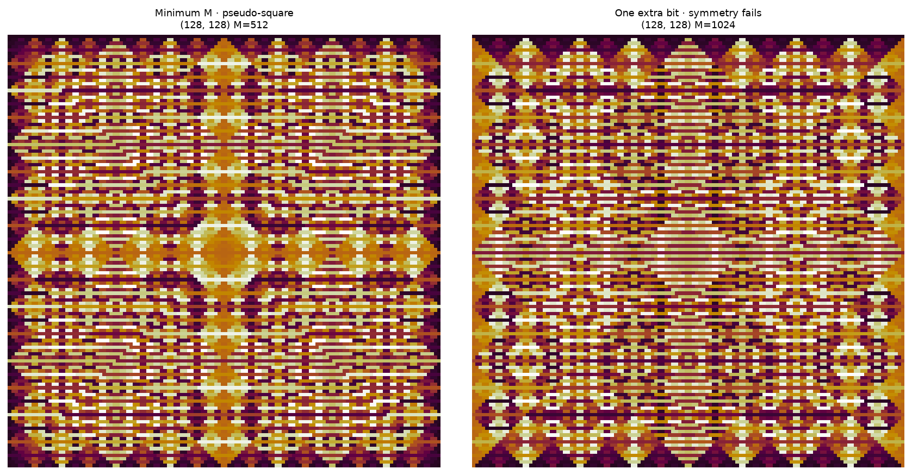

# Tentative XOR symmetry results

This report records new results from the November 10–12, 2026 chat. See the [exploration index](README.md) for status, scope, and related results.

Fix displayed side $N = 2^r \ge 4$, pre-modulus $K = 2N$, no pre-operation, and the current vertical opposite-checkerboard sampling. Require least horizontal and vertical periods $N$. All arithmetic is exact integer arithmetic. The post-polynomial $H$ has arbitrary integer coefficients and finite degree; its post-modulus is a power of two.

Here pseudo-square symmetry means the complement symmetry $H(2N-z) \equiv H(z)\pmod M$ on every odd raw input $0 < z < 2N$. This is necessary and sufficient for the extra axial mirrors, hence square symmetry, of each mixed Cartesian parity component. On even/odd sampling the raw input is $2(i \mathbin{\mathrm{XOR}} j)+1$, and reflecting one axis sends it to $2N-z$. The opposite checkerboard interlaces the two rotated components with their symmetry centers one displayed cell apart. This theorem concerns that numerical symmetry, before palette quantization, rather than a literal quarter-turn of the complete staggered pixel array.

## 1. Necessary and sufficient condition, with the minimum modulus included

Write $\nu_2(0) = \infty$. For odd $0 < z < N$, let $D(z) = H(z+N)-H(z)$. Define

$$
d_0=\min_{\substack{0<z<N/2,\,z\text{ odd}}}\nu_2(D(z)),\qquad d_1=\min_{\substack{N/2<z<N,\,z\text{ odd}}}\nu_2(D(z)).
$$

A horizontal or vertical half-period displacement toggles the raw input's top bit on one of these two quarters. Consequently the target periods are attainable if and only if both depths are finite, and then

$$
m_{\min}=1+\max(d_0,d_1),\qquad M_{\min}=2^{m_{\min}}.
$$

The displayed $N$-shifts preserve the raw XOR table exactly, so they remain periods at every post-modulus. Excluding the two half-shifts excludes every smaller axis period because $N$ is dyadic. Thus every exponent $m \ge m_{\min}$, and only those exponents, gives the target periods.

Define the reflection depth

$$
s=\min_{\substack{0<z<2N,\,z\text{ odd}}}\nu_2\bigl(H(2N-z)-H(z)\bigr).
$$

The exact simultaneous criterion is

$$
\boxed{m_{\min}\le m\le s.}
$$

In particular, pseudo-square symmetry at minimum-period precision is equivalent to $s \ge m_{\min}$, or $s > \max(d_0,d_1)$. If it fails at the minimum modulus, no larger dyadic modulus retaining the period can restore the symmetry. Increasing the modulus only strengthens the required divisibility of each reflection difference.

The two quarter-depth conditions belong specifically to the current opposite-checkerboard map. Mixed Cartesian sampling has a different period test, while its complement-symmetry criterion is the same.

## 2. Complete constructive family at every modulus

Define

$$
\phi_N(z)=z(2N-z).
$$

For every integer polynomial $G$, the post-polynomial

$$
\boxed{H(z)=G(\phi_N(z))}
$$

satisfies $H(2N-z) = H(z)$ as an equality of integers. Therefore its complement symmetry survives every post-modulus, including its minimum-period modulus whenever the target is attainable. No even-power restriction on its expanded coefficients is needed. For a guaranteed nonconstant, period-attainable choice, take $G$ nonconstant with nonnegative coefficients: $G$ is strictly increasing on the positive feature values, and the feature values in each half-period input pair are different.

The construction is complete at the level of polynomial output tables: every integer-polynomial table with the complement symmetry at a fixed power-of-two modulus has a representative of this form at the same modulus. It may have multiple such representatives.

**Proof of completeness.** Put $x = z-N$, which is odd, and expand

$$
H(N+x)=A(x^2)+xB(x^2),\qquad A,B\in\mathbb Z[t].
$$

Complement symmetry says $2xB(x^2) = 0$ modulo $M$ on the actual odd input set. Since $x$ is a unit modulo $M$, $2B(x^2) = 0$. Since $x-1$ is even, $xB(x^2) = B(x^2)$ modulo $M$. Therefore the same output table is represented by $A(x^2)+B(x^2)$. Finally $x^2 = N^2-\phi_N(z)$, so

$$
G(t)=A(N^2-t)+B(N^2-t)
$$

has integer coefficients and gives the required representation. Equality modulo $M$ implies equality modulo every smaller dyadic modulus as well. Thus if the original $H$ was at minimum-period precision $M$, its representative is at that same minimum-period precision.

The fixed-sum/product idea is the classical [symmetric-polynomial construction](https://kconrad.math.uconn.edu/blurbs/galoistheory/symmfunction.pdf). The odd-input modular completeness statement above follows from its explicit proof, including the possible two-torsion in $B$.

## 3. Broad automatic guarantee for ordinary even polynomials

**Corollary.** If $H(-z) = H(z)$ as an integer polynomial and its minimum-period modulus satisfies

$$
\boxed{M_{\min}\le 2N^2,}
$$

then the pattern is pseudo-square-symmetric. This is sufficient, not a claimed sharp boundary.

**Proof.** If $M \le 2N$, integer polynomial congruence preservation and evenness already give $H(2N-z) \equiv H(z)\pmod M$. Otherwise put $L = M/(2N)$, a positive integer power of two, with $L \le N$ by the assumed bound.

At $M/2$ at least one half-period has returned, by minimality of $M$. Since $N^2$ is divisible by $M/2$, Taylor expansion with integer coefficients gives

$$
H(z+N)-H(z)\equiv NH'(z)\pmod{M/2}.
$$

Thus $H'(z)$ is divisible by $L$ on one of the two odd-input quarters. For an even polynomial every coefficient of $H'$ is even. Hence

$$
H'(z+N/2)-H'(z)\equiv0\pmod N.
$$

Since $L$ divides $N$, quarter translations propagate that divisibility to all odd inputs. Finally, using evenness and the divisibility of $(2N)^2$ by $M$,

$$
H(2N-z)-H(z)\equiv-2NH'(z)\equiv0\pmod M.
$$

This proves the corollary without a degree bound or any coefficient-sign restriction.

For example, at $N = 1024$ the upper bound is 2,097,152. The current even-only gallery strata use $M$ at most 32,768, so after reducing every draw to its minimum-period modulus this corollary guarantees the complement symmetry. More generally it covers all current even-only precision strata at $N \ge 16$ after that reduction.

## 4. Even-only is insufficient at unrestricted minimum precision

Take $N = 8$, $K = 16$, and

$$
H(z)=z^6+25z^4+11z^2.
$$

The two quarter-depth minima are both 11, so the minimum-period modulus is 4096. Direct native evaluation gives least periods $(8,8)$ there, and $(4,4)$ modulo 2048. However

$$
H(1)\equiv37,\qquad H(15)\equiv2085\pmod{4096}.
$$

The complement symmetry fails at the actual minimum modulus. Its reflection depth is 11, below $m_{\min} = 12$, so no dyadic post-modulus can give both the requested periods and the complement symmetry for this fixed $H$.

## 5. Verification

The companion [exact verification script](xor_checks.py) independently checks the counterexample's periods using the native evaluator. It also checks 2,400 even-only polynomials over sides 4,8,16,32 and six precision strata. All 2,230 samples falling under the corollary's bound satisfy the reflection condition. Eleven sampled minimum-period tables lack that symmetry outside the bound. All 2,389 symmetric minimum-period tables agree with their constructed $G(\phi_N)$ representatives. These finite computations check the formulas and implementations; the general results rest on the proofs above.

## 6. Fixed-precision derivative shortcut

For an ordinary even polynomial and $M = K\cdot 2^v$ with $0 \le v \le \log_2 K$, integer Taylor expansion gives

$$
H(K-z)-H(z)\equiv-KH'(z)\pmod M.
$$

Indeed $H(-z) = H(z)$, $H'(-z) = -H'(z)$, and every Taylor term of order at least two contains $K^2$, which is divisible by $M$. The complement condition is therefore exactly $H'(z) = 0$ modulo $2^v$ on odd $z$. It suffices to test odd residues modulo $2^v$.

For $v = 1$ every ordinary even polynomial passes. For $v = 2$, if $H(z)=a_0+\sum_j a_{2j}z^{2j}$, it passes exactly when $\sum_j j a_{2j}$ is even, because $H'(z) = 2z\sum_j j a_{2j}$ modulo four on odd inputs. The [earlier same-valuation family](../2026-11-02-xor-polynomial-period/2026-11-02-xor-polynomial-period.md) with positive valuation $v$ automatically has $H'$ divisible by $2^v$ and its balanced modulus fits this symmetry. At arbitrarily high precisions the exact reflection test in Section 1 remains the criterion.

A single even post-power at its balanced minimum modulus is always complement-symmetric. For odd $z$ and even $p$, the lifting formula applied to $K-z$ and $z$ gives

$$
\nu_2((K-z)^p-z^p)=\log_2K+\nu_2(p).
$$

Thus at $M_{\min} = K\cdot 2^{\nu_2(p)}$ the difference vanishes, while at twice that modulus it does not. The simplest notebook example is $p = 2$, $N = 128$, $K = 256$: $M = 512$ has the complement symmetry, and $M = 1024$ loses it. Both retain least axis periods $(128,128)$. $H(1)$ and $H(255)$ give residues $(1,1)$ modulo 512 and $(1,513)$ modulo 1024.

## 7. Spatial centering and scalar reflection centers

Use $(x,y)$ for spatial coordinates with geometric origin at the rug center, $a,b$ for integer sampled operands, and $z = a \mathbin{\mathrm{XOR}} b$ for the post-input. The scalar reflection $z \mapsto 2N-z$ is centered at value $N$; it does not prescribe a spatial origin. Recenter spatial coordinates together with the sample map to place the existing mirror axes through geometric $(0,0)$. This preserves periods and the scalar criterion. A changed sampling phase is an additional choice.

For the current vertical opposite-checkerboard map, $a = i+j$ and $b = j-i-1$. The two Cartesian parity components' square centers are $(i,j) = (-1,0)$ and $(0,0)$ modulo $N$. Their raw combined field has axial mirrors through $i = -1/2$ and $j = 0$. Translating geometric coordinates to $X = i+1/2$, $Y = j$ places those mirrors at the spatial origin while leaving the two component centers staggered at $X = \pm 1/2$.

The operand pair $(a,b) = (0,0)$ has equal parity, so it is absent from the opposite checkerboard. Its absence is compatible with a geometric origin between selected cells. The application's 2× alignment moves XOR's cell-center and cell-boundary axes onto pixel boundaries; it preserves this distinction between spatial placement and scalar-value symmetry.
