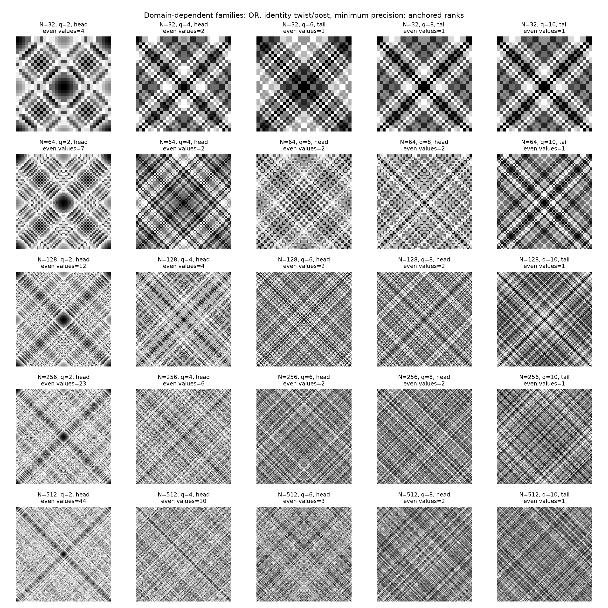
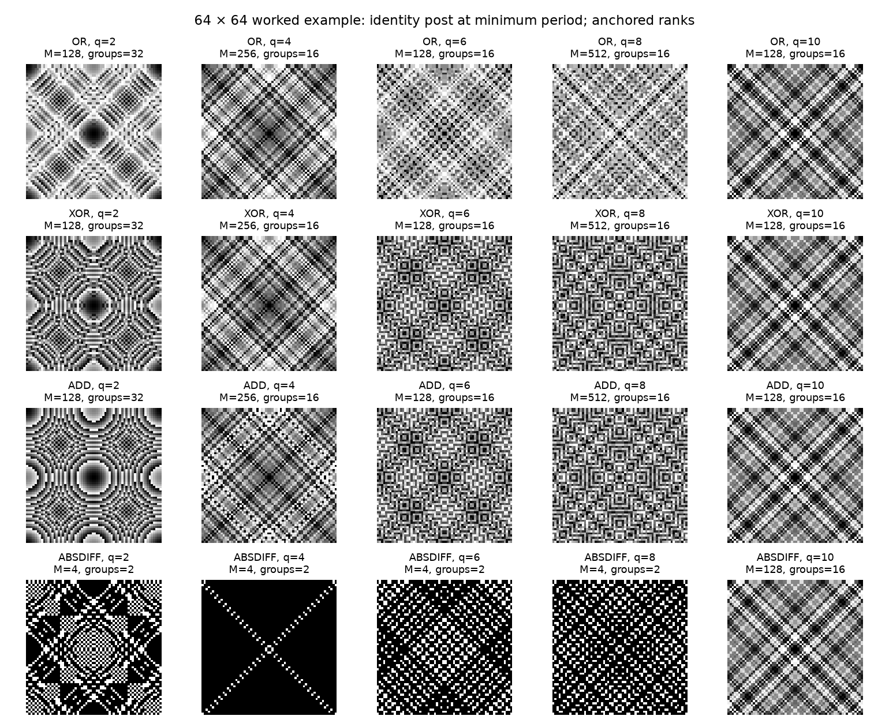
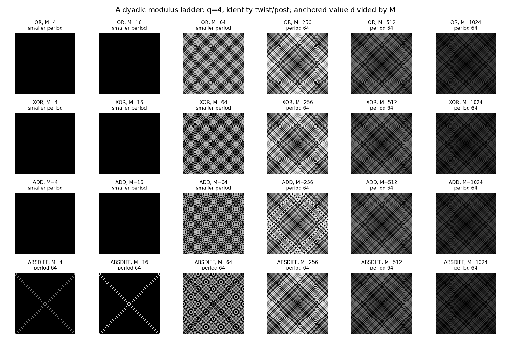

# Coarser head families across domain sizes

Use the general construction and the half-period graph in [theory.md](theory.md). This report identifies exact structural groups that can support style choices. Their aesthetic consistency remains a visual judgement; equal abstract counts do not make spatial patterns identical.

## 1. Group by the surviving even branch

The odd pre-values always fill $1\pmod S$, where $S=2^{w+2}$, with $T=N/4$ values. For pre-inputs of valuation $s\ge1$, the even pre-values vanish if $sq\ge k$. Otherwise they fill exactly the congruence class

$$
f(2^{sq})\pmod{2^{\min(k,sq+w+2)}},
$$

with $2^{\max(0,k-sq-w-2)}$ distinct values. Consequently the number of even pre-values, including zero, is

$$
E=1+\sum_{s=1}^{\lfloor(k-1)/q\rfloor}2^{\max(0,k-sq-w-2)}.
$$

**Proof.** For even $q$, odd unit powers fill $1\pmod{2^{w+2}}$ at higher dyadic precision. Multiplication by $2^{sq}$ gives the powered-input class. The shared twist is a valuation-preserving isometry, so it maps that complete class bijectively to the stated class. Different nonzero layers have different valuations and cannot overlap. The available original inputs cover each class; their number of odd unit representatives exceeds the required image size.

This yields a domain-dependent grouping: the erased branch is the tail; a single surviving even value is a binary even branch; multiple values or valuation layers form a richer even branch. Within the binary case, the relative bit depth of the even value compared with the odd stride is a second useful invariant. This groups arithmetic mechanisms rather than every individual pre-power, combiner, and modulus.

For $q\ge4$, the binary case is exactly $q<k\le q+w+2$. Its two values are zero and $f(2^q)$. Relative to the odd stride, the nonzero value has valuation $q-w-2$. In the special case $k=q+1$, it is exactly $K/2$, independent of the twist.

Pre-powers six and eight share relative depth $q-w-2=3$ and share the residual width $k-q=r-5$. This explains a common coarse scale. They are both binary through side 256. At side 512, pre-power six already has two distinct nonzero even values, whereas pre-power eight still has one. The latter remains binary through side 1024. Their similar appearance does not extend to an identical arithmetic family at all larger domains.

Pre-power four has relative depth zero, so its even value acts at the first variable bit of the odd code. This separates it naturally from the relative-depth-three family at medium sides. Pre-power two also changes a bit below the odd stride and can have several surviving even layers, giving it a separate structural role.

These complete tiles use OR with identity twist and post, at the minimum modulus for that formula. The caption on each panel records the number of distinct even pre-values, including zero. Side 512 is where pre-power six first leaves the binary family while pre-power eight remains in it. Similarity of pre-power four to a tail-looking panel does not make its even branch vanish; the arithmetic cutoff is independent of that resemblance.

## 2. Coarse groups from the half-period components

For OR, a raw half-edge is a loop or toggles the top bit. For XOR, it always toggles the top bit. Their graph components have at most two vertices. For ADD, a raw half-edge changes the integer sum by $K/2$ in absolute value; since its raw range is below $2K$, each component has at most four vertices. ABSDIFF has the same abstract component-size multiset as ADD, as proved below.

For every $q\ge4$, the even pre-values are multiples of $S$, so OR and XOR attain exactly $1\pmod S$ below $K$: the even value zero already exposes that entire class, and the bitwise operations cannot leave it. Each vertex is paired with its top-bit toggle, again witnessed by even value zero. Therefore both have exactly $N/8$ two-vertex components, for every twist, in the head and tail alike.

For pre-power two, XOR instead attains the complete class $1\pmod4$, with $N/2$ vertices and $N/4$ two-vertex components. An even pre-value of valuation two toggles the extra low variable bit, and the complete odd pre-class supplies all higher bits. This also holds at the small sides.

Thus, with arbitrary post-polynomials and their own minimum moduli, the abstract order count of OR or XOR at any pre-power at least four is the tail count for that side. Pre-power-two XOR has the larger count corresponding to twice as many vertices. The original coordinate incidence and the raw equality partition still distinguish the resulting spatial families.

For pre-power-two OR and $N\ge32$, there is a finer exact three-way count. Put $c$ equal to the population count of $(-Q(0))\bmod4$. There are

$$
n=\frac N4\left(1+2^{-c}\right)
$$

raw vertices, all in two-vertex components. The extra OR class has either zero, one, or two forced bits above the fixed low bits. The corresponding component count is $n/2$.

**Proof.** The even inputs of valuation one fill $f(4)\pmod{32}$. Their two potentially forced bits are the binary digits of $(-Q(0))\bmod4$, because $f(4)=4+24Q(4)\equiv4-8Q(0)\pmod{32}$. OR with the complete odd pre-class retains precisely the masks containing those bits. Other nonzero even layers have bit two clear and add no values outside the already complete odd pre-class. For $N\ge32$ the top bit is above both forced bits, so the extra values also pair without fixed points. At sides eight and sixteen, a forced top bit can instead create singleton components; the general graph sampler handles them directly.

## 3. Why ADD and ABSDIFF have matching abstract counts

Let $C=K-S+2$. The map $O\mapsto C-O$ permutes the complete odd pre-class and commutes with its top-bit toggle. For fixed even $E$, the transformed difference is

$$
|(C-O)-E|=|C-(O+E)|.
$$

Every original sum is $1\pmod4$, while $C$ is $2\pmod4$. Hence $C-(O+E)$ is always $1\pmod4$; two such numbers cannot be nonzero negatives of each other. Absolute value is therefore injective on this set. This gives a graph isomorphism from ADD to ABSDIFF, after a permutation of odd operand classes, proving equality of component-size multisets and of the unbounded-polynomial minimum-period order counts.

This correspondence permits a different spatial permutation of the input classes and a different polynomial realization precision. It does not assert equality of their displayed arrays or equality of their polynomial spaces at fixed $M$. ABSDIFF's very small comparison modulus remains a useful distinct style.

## 4. Modulus exploration has no finite upper boundary

For each fixed polynomial, [the exact period theorem](theory.md#1-one-half-period-graph-controls-both-axes) permits every dyadic modulus from its minimum upward. Thus there can be admissible choices between the gallery selectors and above them. Values below the minimum lose the requested period. Moduli between powers of two are outside this study's arithmetic contract.

Once $M$ exceeds the difference between the largest and smallest integer post-output, the anchored order stabilizes. Positive anchored differences precede all wrapped negative ones, with no remaining collisions. Numerical spacings divided by $M$ generally continue to change and can become concentrated near zero and one. Merely exposing larger moduli does not ensure well-spaced colors.

Multiplying the whole post-polynomial and its modulus by the same power of two also preserves the normalized numerical pattern. Therefore choosing modulus exponents uniformly, or summing class counts from several moduli, does not give uniform distinct shift classes across those moduli. Compare reduced dyadic spacings and remove duplicate representations.

If exact equally spaced output levels are desired, impose that as an additional family condition. On a dyadic modulus the number of distinct equally spaced levels must be a power of two. At minimum precision, partners must be separated by exactly half that many ranks. Some attainable general-polynomial orders fail this condition; equal spacing is a meaningful restriction on the sampled family.

## 5. Worked visual comparison

This side-64 example uses the identity twist and post and colors anchored ranks. ABSDIFF's head patterns at modulus four are comparisons with two output groups. The tail starts at pre-power ten here. Other domain sizes have the head lists in [the theory report](theory.md#5-finite-twist-coordinates-at-every-domain).

This second example colors anchored residues divided by the modulus, keeping that numerical scale fixed across panels. It separates loss of period at low precision from the continuing change of color spacing above the minimum. Neither figure is an assertion that every arithmetic member of a coarse family has the same aesthetic quality.
